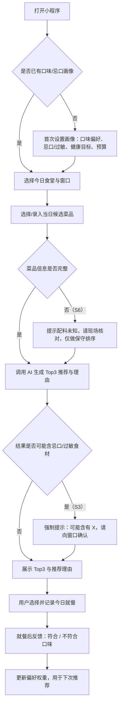
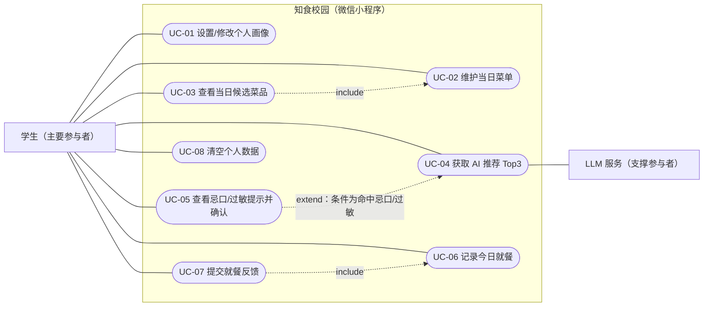

# 实验2：个人软件选题与需求分析

## 学习通提交说明

- **提交平台：** 只向学习通对应的“实验报告”作业上传一份PDF文件。
- **文件命名：** 班级-学号-姓名-实验2-个人软件选题与需求分析.pdf。
- **PDF内容：** 个人项目方案、需求说明V1、用户与场景证据、现有方案比较、用户故事与验收条件、AI能力分析及第2—17周个人计划。
- **截止时间：** 以学习通作业设置为准；报告中的仓库链接与Commit用于过程核验。

## 1. 实验目的

- 围绕真实或明确的用户问题完成个人软件选题，形成可在课程周期内独立完成的项目范围。
- 掌握用户、场景、功能需求、非功能需求、用户故事和验收条件的表达方法。
- 判断AI能力是否真正必要，并明确其输入、输出、价值、风险和非AI降级方案。

> **相关课程参考**
>
> - [Harvard CS85：Introduction to Generative AI via Building Software for the Study of Arts & Sciences（2026课程目录）](https://seas.harvard.edu/computer-science/courses)：参考其从真实领域问题出发、再把问题转换为软件需求的组织方式。本实验要求先说明用户和实际困难，再决定使用什么AI技术。
> - [Harvard CS50：Final Project（2026）](https://cs50.harvard.edu/x/2026/project/)：参考其自主选题、解决真实问题和确定项目里程碑的做法。本课程将其调整为一人一款软件，并在需求阶段明确核心价值、范围和验收条件。

## 2. 实验内容

### 2.1 选题来源与问题陈述

- 用“目标用户—当前情境—主要困难—造成影响—拟解决方式”描述问题，避免使用空泛技术口号。
- 通过一次简短访谈、现场观察、个人真实经历或公开需求材料说明选题来源，并保留问题记录、观察摘要或资料链接等证据。
- 用一句话概括软件的核心价值，并说明用户在使用前后会发生什么可以观察到的变化。

### 2.2 用户画像与典型场景

- 至少定义1类主要用户，说明其目标、能力、使用环境、约束与痛点；项目存在管理者、内容提供者或其他使用者时，再补充相应的次要用户。
- 用具体场景描述用户如何进入软件、完成任务、获得结果，以及失败时如何处理。
- 为主要用户补充至少4个正常场景和2个异常场景，说明两种情况下软件分别应该如何响应。

### 2.3 现有方案与差异化

- 调研至少2个现有相似的产品、人工流程或开源方案，从功能、成本、隐私、易用性和AI能力等方面比较。
- 指出本项目不准备解决的问题，防止需求边界不断扩大。
- 总结现有方案中可以借鉴的设计和仍未解决的问题，明确本项目准备形成的差异。

### 2.4 用户故事、需求与验收条件

- 采用“作为……我希望……以便……”编写用户故事，并用“给定—当—那么”（Given/When/Then）写验收条件。
- 建立用例图、用例描述：编号、描述、优先级、来源、依赖、验收方法等；非功能需求至少覆盖性能、可靠性、安全或可用性中的两类。
- 围绕最核心的用户流程编写3—5个可直接用于后续实验的验收示例，至少包含正常情况、信息不足或失败情况以及需要人工确认的情况。

### 2.5 AI能力必要性与可行性

- 说明AI处理的任务为何难以完全用固定规则解决，明确模型输入、期望输出、允许错误和人工确认点。
- 分析数据来源、模型服务、费用、时延、隐私、幻觉和评测难点，给出非AI降级方案。
- 从2.4的验收示例中选择至少3组，补充输入、期望输出和判定方法，其中包含1组无法处理或需要人工确认的情况。

### 2.6 MVP(Minimum Viable Product)范围与第2—17周计划

- 形成一页个人项目方案，确定本学期只重点完成的一条核心用户流程，列出纳入MVP的功能和明确不在本学期实现的功能。
- 列出每一阶段的可运行成果、验收条件和风险，确保一人能够在课程周期内完成。
- 把计划落实到每周可检查的任务和阶段演示节点，并为可能延期的功能预留删减或替代方案。

## 3. 操作记录

### 3.1 本节撰写要求（修订版）

1. 按 2.1—2.6 逐项记录，每条记录必须写全四要素：**做了什么 → 依据/来源 → 得出什么结论 → 对需求产生了什么影响**，只写结论不给依据视为无效记录。
2. 时间、地点、对象、方式必须可核验：访谈对象用 A/B/C 代称，注明身份特征、时长与周次；现场观察注明时间窗、地点与样本量；现有方案注明名称、查看渠道与访问周次。
3. 引用公开资料须给出名称与链接；链接可能失效的，同时保留截图并编号。**截图、表格、图示统一编号**（表3-x / 图3-x），正文用"见表3-x / 见图3-x"引用，图下必须配一句文字说明。
4. 需求变化逐条登记到"需求变化台账"（触发来源、变更前、变更后、原因、对计划的影响），并同步更新《需求说明V1》的版本号（v0.1 → v0.2 → …），不得只保留最终版本。
5. 被否决的方案与被删除的需求必须留痕，写清"为什么不要它"，防止后续反复回到已被否定的范围。
6. 过程材料统一提交到个人仓库，给出**文件路径 + Commit 短哈希**；每次实质性修改独立提交，Commit 信息写明"改了什么 + 为什么改"。

> **填写说明**：本稿的需求分析于第2周完成，周次按教学周计；文中【待填：…】项（具体日期、真实姓名、仓库地址与 Commit）须按实际情况替换后再导出 PDF。
>
> **数据状态（重要）**：三类证据完成度不同，引用时不要混为一谈——**①公开需求材料：已完成**（3.2.4 材料1—4，含链接与访问日期 2026-09-27，其中材料1 为规章原文摘录，可直接引用）；**②现有方案对比：已完成分析，截图待补**（3.4、表3-4）；**③访谈与现场观察：尚未采集**（3.2.1、3.2.2 为调研计划，表3-1 是访谈计划表、表3-2 是空白记录模板，不含任何引语与计数）。因此 3.3—4.5 与附录中标注"来源：访谈A/B/C/W、现场观察"的条目为**待验证假设**，不是已证实的事实。采集工具见同目录 `调研工具-访谈提纲与观察记录表.md`；真实采集完成后按附录E 第 3、4 项更新全文，并删除本说明。

### 3.2 调研过程与信息源（对应 2.1）

**项目暂定名**：知食校园——校园食堂智能选餐助手（微信小程序，学生端）。

**3.2.1 方法与样本（调研计划，待执行）**

选题阶段定为三种方式交叉取证，避免只凭个人印象定需求：半结构化访谈 4 人（学生 3 人 + 食堂窗口工作人员 1 人，每人 5—8 分钟）、午间高峰现场观察 1 次（目标样本 20 人，计数口径见 3.2.2）、现有方案体验 4 类（见表3-4）。

- 计划执行时间：第2周内完成（访谈约 30 分钟、观察约 40 分钟，共约 1 小时，可拆两天；具体日期【待填】），采集工具见 `调研工具-访谈提纲与观察记录表.md`（含开场告知话术、学生版 8 问、工作人员版 5 问、记录表与判定口径，另有"15 分钟最小证据版"操作流程）。
- 结果填写位置：访谈 → 表3-1；观察计数 → 表3-2；两者共同支撑 3.2.3 的问题假设。
- 证据强度区分：现有方案对比（3.4）不依赖访谈，属本人可独立完成的分析（截图S1—S5 待补），访谈与观察为**计划待采集**，两者不混为一谈；采集完成前，本报告涉及访谈与观察的结论一律以"假设"表述。

表3-1 访谈计划与待验证假设

| 代号 | 计划对象特征 | 待验证假设（预期原话方向） | 假设被证伪时的应对 |
| --- | --- | --- | --- |
| 学生A | 大二，有减脂需求 | 假设：认为食堂菜偏油、看不出热量，但拒绝手动记录克重。 | 若受访者并不关心热量 → 下调营养信息在 MVP 中的权重，仅保留"偏油/清淡"标签 |
| 学生B | 大三，海鲜过敏 | 假设：认为菜名看不出配料，且不信任 AI 给出的"安全"结论。 | 若受访者对忌口并不敏感 → 仍保留提示功能但降低优先级，不投入强化确认交互 |
| 学生C | 大一，无特殊需求 | 假设：决策发生在窗口前，推荐条数过多反而增加纠结。 | 若受访者偏好更多选项 → 推荐条数改为可配置，默认仍为 3 条 |
| 工作人员W | 食堂窗口从业者 | 假设：菜单每周轮换且有临时调整，不接受每天上报电子菜单。 | 若窗口愿意配合维护菜单 → 菜单数据风险显著下降，可重新考虑把拍照 OCR 纳入范围 |

> 表3-1 采集后须补上真实的时间地点、时长与原话摘录（**不得使用未采集的引语**），并据此逐条判定上表右列是否触发。

**3.2.2 现场观察计划与计数口径**

- 地点与时段：一食堂一楼取餐区，午间高峰（计划 11:40—12:20，约 40 分钟）。
- 计数口径（先定标准再计数，保证他人可复核）：**直接点单** = 到窗口后 ≤5 秒内说出菜名或指向菜盆、未抬头看菜单牌；**犹豫** = 窗口前停顿 >15 秒（反复看菜单牌、回头张望队列、掏出手机又放回）；**换窗口** = 已进入队列后又离开走向其他窗口；**手机查询** = 明确看到在浏览点评/外卖类页面。同一人只计一项，各项人数之和必须等于观察总人数。
- 记录方式：逐项计数表 + 每 10 分钟记录一次固定窗口的队列人数；只拍环境照片（截图S6 起），不拍人脸。

表3-2 现场观察记录表（空白模板，待填写）

| 观察项 | 计数 | 占比 | 备注 |
| --- | --- | --- | --- |
| 到窗口 5 秒内直接点单 |  |  |  |
| 窗口前犹豫超过 15 秒 |  |  |  |
| 排到一半换窗口 |  |  |  |
| 用手机查过再点单 |  |  |  |
| 观察总人数（目标 n=20） |  | 100% | 各项之和须等于本行 |
| 队列长度（每 10 分钟记 1 次，共 4 次） |  | — | 同时记录估计等待时长 |
| 观察时间 / 地点 / 天气 |  | — | 例：第2周 周三 11:40—12:20，一食堂一楼，晴 |

> 表3-2 为空白模板：采集完成后直接填入计数并按"人数 ÷ 观察总人数"计算占比，**不要保留任何未经观察的数字**。

**3.2.3 问题假设与核心价值（待验证）**

下表是基于现有方案对比（3.4）与日常观察经验推演形成的**问题假设**，须用 3.2.1、3.2.2 的调研结果验证或推翻；任一行被证伪，对应的用户故事（附录A）与验收示例（表3-6）须同步调整。

| 要素 | 内容（假设） | 验证方式 |
| --- | --- | --- |
| 目标用户 | 在校本科生（18—23 岁），日均在校内食堂就餐 1—2 次，午间时间紧张。 | 访谈第 1 问 |
| 当前情境 | 窗口多、菜单不透明或仅现场可见，高峰排队时间长，选择在队伍中仓促完成。 | 访谈第 2、4 问 + 观察队列长度 |
| 主要困难 | ①不知道今天有什么菜；②不知道该选什么；③看不出热量与配料；④忌口/过敏无从确认。 | 访谈第 3、6、7 问 |
| 造成影响 | 午休被挤占、就餐满意度低、健康目标难坚持、存在误食风险。 | 访谈第 4、5、7 问 |
| 拟解决方式 | 轻量获取当日菜单 → AI 解析菜品并给出 3 条可解释推荐 → 用户确认记录并反馈 → 偏好闭环更新。 | 访谈第 8 问（是否愿意使用、最在意什么） |

- **核心价值一句话**：把"今天吃什么"从到窗口前盲目排队，变成出发前 30 秒内有依据的决策。
- **预期可观察的变化（待验证）**：由"排到队才决定/随机选"变为"出发前已确定目标窗口与菜品"；由"反复只吃同几样"变为推荐覆盖更多菜品；由"不知道是否含忌口食材"变为看到"可能含有"提示并现场核对。

> 其中"营养信息不可得"与"忌口/过敏信息不可得"两项已有**公开材料支持**，见 3.2.4 材料1、材料3，不依赖访谈即可成立。

**3.2.4 公开需求材料（已完成，可核验）**

按 2.1 允许的第三条取证途径"公开需求材料"，已查阅并留存下述依据（**访问日期：2026-09-27**）。这部分证据来自公开可查的法规、标准与公开研究，任何人可复核，是选题来源目前最硬的证据。

**材料1：《学校食品安全与营养健康管理规定》**（教育部、国家市场监督管理总局、国家卫生健康委员会令第45号，2019-02-20 发布，2019-04-01 施行）

- 来源：[教育部官网原文页](http://www.moe.gov.cn/srcsite/A02/s5911/moe_621/201903/t20190311_372925.html)；本次查阅的全文（含条文序号）：[食品伙伴网·法规中心](http://law.foodmate.net/show-195489.html)。
- 原文摘录（与本题最相关的四条）：
  - 第十六条："学校应当建立集中用餐信息公开制度，利用公共信息平台等方式及时向师生家长公开食品进货来源、供餐单位等信息……"
  - 第十七条："学校应当根据卫生健康主管部门发布的学生餐营养指南等标准，针对不同年龄段在校学生营养健康需求，因地制宜引导学生科学营养用餐。**有条件的中小学、幼儿园**应当每周公布学生餐带量食谱和营养素供给量。"
  - 第二十一条："……保障师生家长的**知情权、参与权、选择权、监督权**。学校应当畅通食品安全投诉渠道……"
  - 第四十四条："有条件的学校食堂应当做到**明厨亮灶**，通过视频或者透明玻璃窗、玻璃墙等方式，公开食品加工过程。"
- **对本项目需求的支撑（重点）**：
  1. 学生"看不到今天有什么菜、看不到营养信息"，不是个人抱怨，而是**法定信息公开要求与高校落地现状之间的缺口**：第十六条要求公开的是"进货来源、供餐单位"，**并未要求公开菜谱**；第十七条的"每周公布带量食谱和营养素供给量"只约束"**有条件的**中小学、幼儿园"，**高等学校食堂没有这条强制要求**。这正是高校食堂菜单与营养信息普遍只能"到窗口看牌子"的制度原因——本项目的菜单与营养信息通道，填的正是这个空白。
  2. 第二十一条明确了学生的知情权与选择权，本项目为学生侧提供菜单与营养信息，与规定的立法方向一致、不与之冲突，可作为第十七条"引导学生科学营养用餐"在学生个人端的落地补充。
  3. 第四十四条的"明厨亮灶"说明学校已有"以信息公开降低不确定感"的成熟做法，本项目沿用同一思路，只是把对象从"加工过程"换成"菜品与营养"。

**材料2：《学生餐营养指南》（WS/T 554—2017，国家卫生行业标准）**

- 来源：卫生健康标准网标准全文（[PDF](https://wsbz.nhc.gov.cn/wsbzw/upload/news/1737366103643.pdf)）。标准全文条文以原文为准，本稿只引用其"存在并适用于学校供餐"这一事实。
- 支撑：营养信息的表达有国家标准可依；但该标准的落地载体是学校配餐（带量食谱），**学生个人在窗口前没有任何对应工具**。这解释了本项目为什么只能输出"热量区间 + 不确定度"而不能给精确值——缺少带量食谱数据源（与 3.5 台账 R2 一致）。

**材料3：《预包装食品标签通则》（GB 7718—2025）**

- 来源：食品伙伴网合规解读[《预包装食品致敏物质标示合规指引——GB 7718-2025 新规全解读》](http://info.foodmate.net/reading/show.php?itemid=240159)、[《仅剩半年！食品标签新规即将实施》](https://news.foodmate.net/2026/09/752925.html)（2026-09）。具体条款以标准原文为准，本稿仅为公开解读材料的转述。
- 支撑：预包装食品的**致敏物质标示要求在新标准中进一步强化**，并计划于 2027 年 3 月实施；而**食堂现做现售的菜品没有包装标签**，学生无法像看包装一样获得致敏信息。这说明"忌口/过敏信息不可得"是制度性的空白，需要由"软件提示 + 现场确认"补位，也直接支持 3.5 台账 R3 把 AI 的角色限定为"提示可能含有"而**不承担安全判定责任**。

**材料4：公开研究（佐证"排队影响满意度"与"大学生食物过敏"两个方向）**

- [Assessing Student Satisfaction and Improving Efficiency: A Study on University Cafeteria](https://www.ingentaconnect.com/content/routledg/ujhe20/2024/00000055/00000003/art00007)（2024）：高校食堂效率与学生满意度的关系。
- [高校食堂学生满意度的调查——以兰州某高校为例](https://ir.nwnu.edu.cn/bitstream/39RV6HYL/9928/1/%e9%ab%98%e6%a0%a1%e9%a3%9f%e5%a0%82%e5%ad%a6%e7%94%9f%e6%bb%a1%e6%84%8f%e5%ba%a6%e7%9a%84%e8%b0%83%e6%9f%a5%e2%80%94%e2%80%94%e4%bb%a5%e5%85%b0%e5%b7%9e%e6%9f%90%e9%ab%98%e6%a0%a1%e4%b8%ba%e4%be%8b.pdf)（西北师范大学机构库）：国内高校食堂满意度的实证调查。
- [Food allergy prevalence, knowledge, and behavioral trends among college students — A 6-year comparison](https://www.sciencedirect.com/sdfe/pdf/download/eid/1-s2.0-S2213219816306729/first-page-pdf)：大学生群体食物过敏的普遍性与认知情况研究。
- 支撑：说明"食堂效率／排队影响满意度"与"大学生中存在真实食物过敏与认知不足"都是被公开研究反复关注的问题，不是本项目凭空假设。**注意：本稿不引用任何未读原文的具体数字**，若要引用百分比或样本量，须自行阅读原文后再写。

**证据状态说明**：选题来源已通过作业允许的"公开需求材料"途径取得**可核验证据**（材料1—4，含链接与访问日期）；材料1 的条文为原文摘录，可直接引用。3.2.1、3.2.2 的访谈与现场观察仍为计划，属加分项而非取证前提——即使不做访谈，3.2.3 中"营养信息不可得""忌口信息不可得""高校缺乏菜单公示义务"三条已有材料1、材料2、材料3 支撑。

### 3.3 用户与场景分析的演进（对应 2.2）

场景来自 3.2.3 的问题假设与 3.4 的方案对比，每条场景都标注了**待验证来源**（访谈或观察计划）——在 3.2 的真实数据采集完成前，场景本身也是假设，采集后须逐条回访确认，被证伪的场景要删除。场景设计过程中已做两次调整：初稿的"排队等待中的社交拼单"既没有访谈证据也难以在本学期验证，删除；异常场景由 1 个扩到 2 个（数据源失效 + 菜品信息缺失），依据是"食堂菜单会被临时调整"这一待验证假设——若访谈工作人员W 证实该假设，它属于必然发生的正常异常，必须在设计阶段就处理。

表3-3 场景清单与待验证来源

| 编号 | 类型 | 场景 | 待验证来源 | 软件应有的响应 |
| --- | --- | --- | --- | --- |
| S1 | 正常 | 学生A 中午 11:35 想减脂，打开小程序看推荐并直接去目标窗口。 | 访谈A | 结合"低油/高蛋白"目标给出 3 条推荐与理由，含预算与窗口位置。 |
| S2 | 正常 | 学生C 无特殊偏好，只想换个新口味。 | 访谈C | 优先推荐其近 7 天未点过的菜品，并标注"你没试过"。 |
| S3 | 正常 | 学生B 有海鲜过敏，查看某道菜配料。 | 访谈B | 显示"可能含有虾/蟹，请向窗口确认"，不给安全结论。 |
| S4 | 正常 | 学生点餐后反馈"不符合口味"。 | 观察+访谈C | 记录负反馈并在下次推荐中下调同类口味权重。 |
| S5 | 异常 | 当日菜单为空或未被维护（放假日、临时换菜）。 | 访谈W | 提示"暂无可靠菜单数据"，引导手动选择窗口，不编造菜品。 |
| S6 | 异常 | 菜品只有菜名、无配料信息（如"特色小炒"）。 | 访谈B | 标注"配料未知"，仅做保守排序，并提示现场核对。 |

主要用户画像：在校本科生，手机不离手，愿意花 30 秒做决策但不愿做超过 1 分钟的数据录入；对"AI 猜口味"容忍度高，对"AI 判断能不能吃"容忍度为零。次要用户为食堂窗口从业者，本期**不为其开发功能**，仅在数据来源上依赖其菜单公示。

### 3.4 现有方案调研与取舍（对应 2.3）

第1—2周逐个体验下列 4 类现有方案并整理对比（对比见表3-4，其来源与截图编号见本小节末），第2周完成取舍。这部分是本人可独立完成的实际分析，不依赖访谈结果。

表3-4 现有方案对比

| 方案 | 功能覆盖 | 成本 | 隐私 | 易用性 | AI 能力与可借鉴点 |
| --- | --- | --- | --- | --- | --- |
| 大众点评 / 美团外卖 | 覆盖校外店铺广，有评分与短评；校内档口多未收录，无营养/忌口维度。 | 免费，下单有抽成。 | 需位置与订单数据，较敏感。 | 高，用户已熟悉。 | 推荐排序成熟。可借鉴：评分+短评体系与简单权重排序。 |
| 薄荷健康 / Keep 饮食记录 | 营养库完善；但需手动录入食物与克重，食堂菜品难以匹配。 | 会员收费。 | 需身体数据，敏感度高。 | 低，坚持率差。 | 可借鉴：营养"区间 + 不确定度"的表达方式，避免伪精确。 |
| 学校后勤/食堂公众号 | 仅公示菜单与价格，更新不稳定，无个性化。 | 免费。 | 无额外采集。 | 高（只读）。 | 无 AI。可借鉴：菜单为权威来源，可作为校验基准。 |
| 宿舍群接龙 / 口头约定（人工流程） | 零成本，但依赖人肉，偏好数据不沉淀。 | 免费。 | 群内公开。 | 高。 | 无。可借鉴：极低的录入负担才是可坚持的。 |

**方案来源与截图编号**（表3-4 各行的取证渠道，截图统一编号，导出 PDF 前插入正文）

- 大众点评 / 美团外卖：App 内搜索校园周边店铺并查看评分与短评，计划第2周访问；截图S1（待补）。
- 薄荷健康 / Keep：App 内"饮食记录/食物库"模块，计划第2周访问；截图S2（待补）。
- 学校后勤/食堂公众号：微信公众号历史消息中的菜单公示，计划第2周访问；链接【待填：公示文章链接】，截图S3（待补）。
- 宿舍群接龙 / 口头约定（人工流程）：本楼栋群内实际流程，计划第2周访问；涉及他人信息，截图S4 需打码后补。
- 开源参考（可选）：GitHub 搜索关键词 `recipe recommendation`，计划第2周访问；链接【待填】，截图S5（待补）。

- **借鉴的设计**：轻量录入（不要求用户称重、不要求商家上报）、结果可解释（一句话理由）、评分反馈闭环。
- **仍未解决的问题**：①面向校内食堂的菜品数据几乎无人整理；②忌口与过敏缺乏可靠表达方式，没人敢给结论；③推荐缺少可解释性，用户不知道为什么推这道菜。
- **本项目的差异**：以"轻量菜单获取 + 口味/忌口画像 + AI 生成可解释 Top3 推荐 + 明确的安全免责与人工确认边界"填补上述空白。
- **明确不做（防止范围膨胀）**：实时排队数据、在线点餐与支付、商家端后台、社交拼单与社区、医学营养处方、多校区适配。

### 3.5 需求演进与需求变化台账（对应 2.4）

表3-5 需求变化台账

| 编号 | 触发来源 | 变更前 | 变更后 | 原因 | 对计划/范围的影响 |
| --- | --- | --- | --- | --- | --- |
| R1 | 现场观察（计划）+ 访谈W（假设） | 做"食堂排队实时地图" | 删除该功能，改为"错峰时段静态提示" | 学校无排队数据接口；人工上报存在冷启动与长期维护问题，一人无法覆盖 | 去掉实时性最强的功能，避免 MVP 无法交付；改为依据现场观察得到的时段数据给出固定时段建议（该提示依赖 3.2.2 的观察结果，未采集前不进入 MVP） |
| R2 | 薄荷健康对比（表3-4，截图待补）+ 无标准菜品库 | AI 输出精确热量数值（如 412 kcal） | 输出热量**区间**并标注置信度（低/中/高）与"估算，不用于医学用途" | 无权威菜品营养库，精确数值属于伪精确，会误导减脂用户 | 验收标准由"数值误差"改为"区间是否合理 + 是否标注不确定度" |
| R3 | 访谈B（假设） | 由 AI 判断菜品"是否含过敏原" | AI 仅输出"可能含有 X，请向窗口确认"，并强制人工确认 | 误食后果不可接受，用户也不信任 AI 的安全结论 | 新增强制确认点与提示文案验收项，成为验收示例 V3 |
| R4 | 访谈C（假设） | 推荐 5 条 | 推荐 3 条 | "太多反而更纠结"，与"30 秒决策"目标冲突 | 验收示例的判定项改为"输出恰为 3 条且理由与画像一致"；若调研显示用户偏好更多选项，则改为可配置、默认 3 条 |
| R5 | 费用与时延约束（已确认的工程约束） | AI 为唯一推荐路径 | 增加**非 AI 规则降级**为必做项 | 模型服务可能超时或超额，核心流程不能中断 | 调整阶段顺序：第5—7周先实现规则排序版并直接作为降级路径；降级进入验收示例 V4（见附录D 表D-1） |

> 表3-5 的证据强度：R1、R3、R4 的行内"触发来源"目前是**待验证假设**（访谈与观察尚未采集，见 3.2）；R2 依据的是表3-4 的方案对比（本人可独立完成，不依赖调研），R5 依据的是工程约束，这两条可以先行落地。真实采集后须逐条复核 R1、R3、R4 是否成立。

**需求说明版本计划**：《需求说明V1》v0.1（第2周末，保留实时排队地图与 5 条推荐的原方案，用于留痕）→ v0.2（调研完成后按真实发现落实或修正 R1—R5）→ v1.0（提交版，与本文档一致）。

**核心用户流程（收敛结果）**

图3-1 核心用户流程图（说明：蓝框为处理步骤，菱形为决策点，红框为异常场景与强制人工确认支路，分别对应场景 S6 与 S3。**已渲染为图片** `图3-1-核心用户流程图.png`（2400×2400 像素，300 dpi），插入 PDF 时用此文件；下附 Mermaid 源码作为可编辑底稿。）

**验收示例（可直接用于后续实验）**

表3-6 验收示例与判定方法

| 编号 | 类型 | 给定（Given） | 当（When） | 那么（Then） | 判定方法 |
| --- | --- | --- | --- | --- | --- |
| V1 | 正常 | 已设置画像：可接受微辣、减脂目标、预算 15 元 | 录入 4 道候选菜品并请求推荐 | 返回恰为 3 条推荐，理由与画像一致，JSON 字段完整，无风险食材提示 | 人工核对 ≥2 条合理，字段无缺失 |
| V2 | 信息不足 | 候选菜仅"特色小炒"（无配料），或当日菜单为空（场景 S6 / S5） | 请求推荐 | 显示"配料未知"或"暂无可靠菜单数据"，仅做保守排序 | 输出中**不得出现**任何未提供过的菜名或配料，且不得出现"不含 X"等确定性安全表述 |
| V3 | 需人工确认 | 画像含"花生过敏" | 候选菜中出现"宫保鸡丁"并请求推荐 | 必须提示"可能含有花生，请向窗口确认"，确认后方可记录该菜品 | 确认弹窗存在、未确认时无法记录、操作留痕 |
| V4 | 失败/降级 | 模型服务超时、报错或超出费用阈值 | 用户请求推荐 | 返回规则排序结果并提示"AI 暂不可用，以下为按口味标签排序的结果" | 核心流程不中断，提示文案清晰，响应仍满足表C-1 NFR-01 |
| V5 | 反馈闭环 | 今日已记录"水煮鱼"并获得过推荐 | 就餐后反馈"不符合口味（太辣）" | 负反馈入库，下次推荐中同类辣味菜品排序下降或不再出现 | 连续两次请求对比，Top3 变化可解释，该菜品不再进入 Top3 |

> 表3-6 用"给定—当—那么"表述：**给定/当**两列即 2.5 要求的"输入"，**那么**列为"期望输出"，最后一列为"判定方法"，一张表同时满足 2.4 与 2.5 的表述要求。V5 的状态列可见附录B 用例 UC-07。

非功能要求（覆盖性能与安全两类）：推荐接口 P95 时延 < 5 秒；AI 不可用时功能可用率 100%（降级路径）；仅采集昵称与画像，不采集学号、姓名与位置，画像可一键清空。

### 3.6 AI 能力论证与降级方案（对应 2.5）

- **为什么固定规则不够**：菜名是自然语言（"鱼香肉丝""口水鸡"），同一菜名在不同窗口的辣度、配料都不同；学生的口味表达同样是自然语言（"不太能吃辣""想吃清淡点"）。用规则需要穷举词表与映射表，新菜名与临时菜品无法覆盖，维护成本随菜品数量线性上升；语义匹配与理由生成恰是 LLM 的长处。
- **输入**：当日候选菜品文本（菜名、价格、可选人工补充说明）+ 用户画像（口味标签、忌口/过敏清单、健康目标、预算区间）+ 近期反馈记录。
- **期望输出**：结构化 JSON——Top3 菜品（推荐分 0—1、一句话理由、可能含有的风险食材）、建议就餐时段；**禁止输出任何确定性安全结论**。
- **允许的错误**：口味排序错可接受（用户可换一个）；忌口/过敏相关一律保守，宁可误报不可漏报，并强制人工确认。
- **人工确认点**：①出现忌口/过敏提示时；②菜品信息缺失或与现场不符时；③首次设置画像时。
- **数据来源**：食堂公示菜单（复制文本/手动勾选，MVP 不做拍照 OCR）；不涉及个人敏感数据。
- **模型服务与费用**：调用商用 LLM API（如 DeepSeek），单次约 1k tokens，按每日 2 次估算，个人测试期每月可控制在 10 元以内；推荐结果做 24 小时缓存以继续降本。
- **时延与可靠性**：目标 P95 < 5 秒，超时即降级为规则排序（R5）。
- **隐私**：不上传照片原图与学号姓名，画像可一键清空。
- **幻觉对策**：只允许模型在候选菜品集合内选择（受约束输出）；配料置信度必须标注；缺失时显示"未知，请现场确认"而非补全。
- **评测难点与办法**：推荐"对不对"没有标准答案。用 30 组人工标注样本（菜名 → 口味/食材标签）评估解析准确率；用"推荐采纳率""换一个比例""负反馈率"评估推荐质量；安全类用例（V2、V3）采用 100% 通过的硬门槛。

### 3.7 过程材料与版本记录（对应 3.1 第6条）

表3-7 过程材料清单与仓库位置

| 材料 | 仓库路径 | 说明 | Commit |
| --- | --- | --- | --- |
| 访谈提纲与记录 | `docs/evidence/interview-notes.md` | 4 人访谈，代称 A/B/C/W（**待采集**，含空白记录模板与待验证假设） | 593b3e4 |
| 现场观察记录表 | `docs/evidence/observation-record.md` | 表3-2 的空白模板、计数口径与照片位置（**待采集**） | 593b3e4 |
| 现有方案对比 | `docs/analysis/competitor-compare.md` | 表3-4 及截图S1—S5（截图待补） | b25f50b |
| 项目方案（一页） | `docs/plan/project-one-pager.md` | MVP 边界与第2—17周计划、成功标准 | 8667095 |
| 需求说明V1 | `docs/requirements/需求说明V1.md` | v0.1 → v0.2 → v1.0 版本留痕（v0.1 保留被删除的排队地图需求） | cb4ce79 |
| 用户故事、用例与非功能需求 | `docs/requirements/use-cases.md` | 表A-1（10 条故事）、表B-1（UC-01—08）、表C-1（12 条非功能需求） | 1887aef |
| 验收示例与 AI 评测用例 | `docs/requirements/acceptance-cases.md` | 表3-6，含 V1—V5 与评测办法 | 1887aef |
| 公开需求材料摘录 | `docs/evidence/public-materials.md` | 3.2.4 材料1—4 的链接、原文摘录与访问日期（**已完成**） | b25f50b |
| 调研工具（提纲与记录表） | `docs/evidence/survey-toolkit.md` | 访谈提纲、观察记录表、判定口径与 15 分钟最小证据版 | 593b3e4 |
| 报告正文与图示 | `docs/report/实验2-个人软件选题与需求分析.md`、`docs/report/图/` | 本文档；`图B-1-用例图.png`、`图3-1-核心用户流程图.png`；渲染脚本见 `tools/` | 593b3e4 |

- 仓库地址：【待填：Github/Gitee 仓库链接】。本地仓库已初始化并产生 **5 个真实提交**（`main` 分支，见下表），创建远程仓库后 `git push -u origin main` 即得到链接。
- 本次提交历史（可核验需求变化过程）：

| 顺序 | Commit | 提交信息 |
| --- | --- | --- |
| 1 | 8667095 | 需求说明V1 v0.1：初始方案（含食堂排队实时地图、5 条推荐、AI 判定过敏原） |
| 2 | cb4ce79 | 落实需求变化 R1—R5：删除实时排队地图、热量改区间估算、忌口只提示不判定、推荐 5→3、增设非 AI 降级路径 |
| 3 | 1887aef | 补齐用户故事（10 条）、用例描述（UC-01—08）、非功能需求（12 条）与验收示例 V1—V5 |
| 4 | b25f50b | 新增现有方案对比与公开需求材料摘录（法规原文、标准、公开研究，含链接与访问日期） |
| 5 | 593b3e4 | 新增实验2 报告正文、访谈与观察记录模板、图示渲染脚本与用例图/流程图 PNG |

- **留痕要点**：第 1 个提交保留了被删除的"食堂排队实时地图"与"AI 判定过敏原"需求，第 2 个提交说明删除原因（R1、R3）。评委按提交顺序即可看到需求从 v0.1 收敛到 v1.0 的全过程，而非只看到最终版；这也是 2.1、2.3 要求的"方案取舍过程"证据。

## 4. 实验小结

### 4.1 本节撰写要求（修订版）

1. 结论式小结，控制在**一页以内**，必须覆盖四件事：最终选题与一句话价值、核心用户流程、MVP 边界（做什么/不做什么）、AI 能力的必要性结论。
2. 至少说明**一次**需求变化、删减或取舍，写清"触发来源—原方案—变更后—原因—牺牲了什么"，不能只写"经过讨论进行了优化"。
3. 小结中的结论必须与第 2、3 部分一致，不得引入前文未出现的新需求。
4. 明确尚未解决的遗留问题、最大风险与对应的删减预案。
5. 能量化就量化（时延、推荐条数、费用、样本量），避免"提高效率""提升体验"这类不可验证的表述。

### 4.2 最终选题与核心价值

最终选题为**知食校园——校园食堂智能选餐助手**：面向在校本科生，针对"不知道今天有什么菜、不知道该选什么、看不出热量与配料、忌口无从确认"四个连在一起的困难假设（见 3.2.3，尚待调研验证）。一句话价值是"把今天吃什么，从到窗口前盲目排队变成出发前 30 秒内有依据的决策"。预期可观察的变化有三个：决策点从窗口前移到出发前；菜品选择从"反复吃同几样"变为被推荐覆盖更多菜品；忌口从"凭感觉"变为看到"可能含有"提示后现场核对。

### 4.3 核心用户流程与 MVP 边界

本学期只重点打通**一条**流程（见图3-1）：设置口味与忌口画像 → 选择当日窗口与候选菜品 → 获得 AI 推荐 Top3 与理由 → 选择并记录 → 反馈 → 偏好更新。选择这条流程的理由有两点：一是它直接对应 3.2.3 里最核心的困难假设（决策发生在窗口前、信息在出发前不可得），二是它不依赖任何未开放的数据源；反过来，排队实时数据因数据源不可得而被排除（R1）。**该理由的成立以 3.2 的调研为前提**：若调研发现学生并不在窗口前犹豫或对菜品信息无需求，这条流程需要重新评估。

表4-1 MVP 边界

| 纳入 MVP（本学期必须完成） | 不纳入本学期（明确不做） |
| --- | --- |
| 学生端微信小程序（画像设置、窗口与菜品选择、推荐展示、记录与反馈） | 实时排队数据与食堂端上报 |
| 当日菜单的轻量维护（文本导入 + 手动修正） | 在线点餐、支付与订单 |
| AI 推荐 Top3 + 一句话理由 + 风险食材提示 | 商家端后台与经营分析 |
| 忌口/过敏的强制人工确认点 | 社交拼单、菜品点评社区 |
| 非 AI 规则排序降级路径 | 拍照 OCR 自动识别菜单、多校区适配 |
| 画像本地可清空、数据最小化 | 医学营养处方与疾病相关建议 |

### 4.4 AI 能力的必要性结论

AI 在本项目中**必要但不越界**。必要：菜名与口味偏好都是自然语言，规则方案需要维护不断增长的词表与映射，而新菜名、临时菜品无法预先覆盖，语义匹配与推荐理由生成只能用模型完成。不越界：涉及"能不能吃"的安全判断一律不交给模型，只输出"可能含有 X，请向窗口确认"（R3），把最终判断权交回用户与窗口。因此设计上保留了非 AI 降级路径：模型超时或超额时按口味标签匹配与历史反馈排序，核心流程仍可用，只是解释性与新菜名覆盖能力下降。若完全去掉 AI，本项目会退化为一个"标签匹配排序工具"，仍可用但差异化消失——这也是把 AI 纳入 MVP 而非"以后再说"的理由。

### 4.5 一次需求变化、删减与取舍

最典型的一次是**删除"食堂排队实时地图"（R1）**。触发来源有两部分：一是已经确认的工程事实——学校不开放排队数据接口，唯一可行方案是让学生或窗口人工上报；二是待验证假设——若访谈工作人员W 证实窗口不接受每天上报菜单，人工上报在冷启动阶段几乎必然是空数据。因此在**不确定性最高**的环节直接删除该功能，改为"错峰时段静态提示"，且该提示依赖现场观察结果，观察未完成前不进入 MVP。这次取舍牺牲的是产品最直观的"实时感"和潜在亮点，换来的是 MVP 在一人一学期内可交付、且不依赖任何外部承诺。同类取舍还有三次：把精确热量改为区间估算（R2，依据表3-4 的方案对比，牺牲精度换可信度）、把 AI 安全判断改为人工确认（R3，依据访谈B 的待验证假设，牺牲便利换安全责任边界清晰）、把 5 条推荐减为 3 条（R4，依据访谈C 的待验证假设，牺牲信息量换决策速度——若调研显示用户偏好更多选项，则改为可配置）。四次取舍的共同判据是：**凡是自己无法持续维护的数据或无法承担后果的判断，都不进入 MVP。**

### 4.6 遗留问题与风险预案

- 最大风险仍是**菜单数据维护成本**：即便采用轻量录入，每天维护新菜单仍可能在第6周后失去动力。预案是先用"同一菜单按周复用 + 只维护变化项"，并在演示前保证一周数据完整即可，不追求全量覆盖。
- 评测样本量偏小（30 组标注），只能说明解析趋势，无法给出统计意义上的准确率，报告中如实说明样本量限制，不夸大为"准确率达标"。
- 费用与时延尚未实测：第8周接入模型后须记录真实 token 消耗与 P95 时延，若超出"每月 10 元 / 5 秒"的假设，则扩大缓存范围并优先使用规则降级路径（见附录D 表D-2 第8、11周）。
- 若时间不足需要二次删减，按优先级从后往前砍：先砍错峰提示，再砍反馈闭环，最后才考虑退回纯规则推荐版——**画像设置、Top3 推荐与忌口提示三条不可删**，它们构成项目的核心价值。删减顺序与替代方案见附录D 的 D.5。

---

## 附录（补齐 2.4、2.6 要求的交付物）

> **编写说明**：第1、2部分为课程要求原文，本报告不作改动。2.4（用户故事、用例图与用例描述、非功能需求）与 2.6（一页项目方案、第2—17周计划）要求的交付物以附录形式给出，编号体系独立（表A-1、图B-1、表C-1、表D-1/D-2、表E-1）。附录与第3、4部分内容严格一致，同属提交 PDF 的组成部分。

### 附录A 用户故事清单（对应 2.4）

编写规则：①一条故事只承载一个可验证的价值点，不写"系统应该…"这类实现描述；②优先级是第2—17周取舍的依据（高=不做则核心价值不成立）；③每条故事标注取证来源，确保不是凭空设想；④已被删除的故事单独列出并说明原因，防止范围反复。

表A-1 用户故事清单

| 编号 | 角色 | 用户故事（作为…我希望…以便…） | 优先级 | 来源（待验证） | 关联场景 | 对应验收示例 |
| --- | --- | --- | --- | --- | --- | --- |
| US-01 | 在校学生 | 作为在校学生，我希望出发去食堂前就能看到今天的候选菜品，以便不用排到窗口前才决定吃什么。 | 高 | 访谈C、现场观察 | S1 | V1 |
| US-02 | 有减脂需求的学生 | 作为正在减脂的学生，我希望推荐里标注热量区间和油盐倾向，以便在不称重、不记录克重的前提下大致控制摄入。 | 高 | 访谈A | S1 | V1 |
| US-03 | 固定口味的学生 | 作为口味比较固定的学生，我希望系统记住我的口味偏好并据此推荐，以便每次少花时间重新挑选。 | 高 | 访谈A、访谈C | S1、S2 | V1 |
| US-04 | 有过敏史的学生 | 作为对海鲜过敏的学生，我希望菜品可能含有过敏原时看到明确提示，以便决定是否向窗口当面确认。 | 高 | 访谈B | S3 | V3 |
| US-05 | 容易纠结的学生 | 作为容易纠结的学生，我希望一次只看到 3 条推荐并各附一句理由，以便在 30 秒内做出决定。 | 中 | 访谈C | S2 | V1 |
| US-06 | 想换口味的学生 | 作为吃腻了固定几样的学生，我希望看到最近没点过的菜品，以便不再反复吃同几样。 | 低 | 访谈C | S2 | V5 |
| US-07 | 普通就餐学生 | 作为普通学生，我希望就餐后一键反馈"符合/不符合口味"，以便下次推荐更贴近我的口味。 | 中 | 现场观察、访谈C | S4 | V5 |
| US-08 | 有过敏史的学生 | 作为有忌口的学生，我希望信息缺失的菜品明确显示"未知"，以便我不会把"没提示"误当成"没问题"。 | 高 | 访谈B | S6 | V2 |
| US-09 | 菜单维护者（学生本人） | 作为菜单维护者，我希望菜单没维护好时软件如实提示"暂无可靠数据"，以便软件不编造菜品误导我。 | 中 | 访谈W | S5 | V2 |
| US-10 | 注重隐私的学生 | 作为注重隐私的学生，我希望一键清空我的口味与就餐记录，以便数据始终由我自己掌控。 | 中 | 隐私自查（表3-4 隐私维度） | — | 表C-1 NFR-07 |

**已删除的用户故事（留痕）**：US-X1"作为学生，我希望看到各窗口的实时排队人数"与 US-X2"作为学生，我希望和同学拼单一起点餐"，均在第2周讨论中删除——前者无可用数据源（见 3.5 台账 R1），后者在调研计划中无任何证据支持且难以在一学期内验证。二者的编号不再复用，避免后续被重新捡回。

> 表A-1 的"来源（待验证）"列指向 3.2 的调研计划：访谈与现场观察**尚未采集**，因此这 10 条故事目前是**待验证假设**，不是已证实的用户需求。采集完成后须逐条确认或删除，并同步修正关联场景（表3-3）与验收示例（表3-6）。例外：US-10 的来源是对照表3-4 隐私维度的自查，不依赖调研。

**优先级分布**：高 5 条（US-01—US-04、US-08）、中 4 条（US-05、US-07、US-09、US-10）、低 1 条（US-06）。第2—17周的实施顺序按优先级降序，低优先级故事排在反馈闭环之后（见附录D 表D-2）。

### 附录B 用例图与用例描述（对应 2.4）

图B-1 用例图（说明：方框为系统边界，椭圆为用例，左侧为直接参与者"学生"，右侧为支撑参与者"LLM 服务"；实线为参与者与用例的关联，虚线为用例之间的 include（包含）/ extend（扩展）关系。**已渲染为图片** `图B-1-用例图.png`（2300×1880 像素，300 dpi），插入 PDF 时用此文件；下附 Mermaid 源码作为可编辑底稿，矢量源文件为 `图B-1-用例图.svg`，可用 `render-usecase.ps1` 重新渲染。）

表B-1 用例描述表

| 编号 | 用例名称 | 描述与主流程 | 优先级 | 来源（待验证） | 依赖/前置 | 异常流程与验收方法 |
| --- | --- | --- | --- | --- | --- | --- |
| UC-01 | 设置/修改个人画像 | 学生填写口味偏好、忌口/过敏清单、健康目标与预算，保存后可随时修改。主流程：进入画像页 → 逐项选择（可跳过）→ 保存到本地并同步云端。 | 高 | 访谈A、访谈C | 首次使用时触发 | 异常：用户跳过忌口项，允许跳过，但在首次推荐前再轻提示一次。验收：保存后重启小程序仍可读取并影响推荐（V1 前置条件）。 |
| UC-02 | 维护当日菜单 | 粘贴/导入食堂公示菜单文本 → 系统解析为菜品列表（菜名、价格）→ 学生人工修正错漏。主流程：选择窗口 → 粘贴文本 → 核对并修正 → 保存。 | 高 | 访谈W | 无 | 异常：文本为空或无法解析 → 提示逐条手动添加，**不编造菜品**（S5）。验收：能录入 10 道菜并成功修正 3 处错误。 |
| UC-03 | 查看当日候选菜品 | 按食堂/窗口浏览当日菜品与价格，作为推荐的候选集合。 | 高 | 现场观察 | 依赖 UC-02 | 异常：当日菜单为空 → 显示"暂无可靠菜单数据"。验收：见表3-6 V2。 |
| UC-04 | 获取 AI 推荐 Top3 | 提交画像与候选菜品 → 模型在候选集合内返回恰 3 条推荐（推荐分、一句话理由、可能含有的风险食材）→ 展示。 | 高 | 访谈C | 依赖 UC-01、UC-03 | 异常：超时/报错/超额 → 自动降级为规则排序并明确提示。验收：见表3-6 V1、V4。 |
| UC-05 | 查看忌口/过敏提示并确认 | 命中忌口/过敏时弹出"可能含有 X，请向窗口确认"，用户确认后才可继续。 | 高 | 访谈B | 依赖 UC-04；扩展关系 | 异常：用户不确认 → 该菜品不可被记录。验收：见表3-6 V3（100% 通过的硬门槛）。 |
| UC-06 | 记录今日就餐 | 从推荐中选中或手动选择菜品，记录为今日就餐并进入历史列表。 | 中 | 现场观察 | 依赖 UC-04、UC-05 | 异常：同一天重复记录 → 提示已记录并允许修改。验收：历史列表可查、可改。 |
| UC-07 | 提交就餐反馈 | 一键反馈"符合/不符合口味"，负反馈用于下调同类口味权重。 | 中 | 现场观察、访谈C | 依赖 UC-06 | 异常：未记录就反馈 → 引导先完成记录。验收：见表3-6 V5。 |
| UC-08 | 清空个人数据 | 一键删除画像与就餐记录，删除后 7 天内不可恢复。 | 中 | 隐私自查 | 无 | 异常：误触 → 二次确认弹窗。验收：见表C-1 NFR-07。 |

> 表B-1 的"来源（待验证）"列与表A-1 同源：标注访谈、现场观察的用例目前依据的是 3.2 的调研计划，属待验证假设；标注隐私自查的 UC-08 不依赖调研。用例的优先级会随调研结果调整。

**未纳入本期的用例（明确不做）**：实时排队查询、在线点餐与支付、商家端后台、社交拼单与点评社区、拍照 OCR 识别菜单、多校区适配——原因见表3-4 与 4.3 表4-1。

### 附录C 非功能需求清单（对应 2.4）

按 2.4 要求至少覆盖性能、可靠性、安全、可用性中的两类，本清单四类全覆盖，另补成本与兼容性各 1 条。所有指标均给出**可测的目标值**与验证时间，避免"响应要快""体验要好"这类无法判定的写法。

表C-1 非功能需求清单

| 编号 | 类别 | 需求描述 | 目标值/判定标准 | 验证方法与时间（周次） |
| --- | --- | --- | --- | --- |
| NFR-01 | 性能 | 推荐接口响应时间（含 AI 调用） | 首次请求 P95 < 5 秒；缓存命中 < 1 秒 | 第11周连续 30 次请求计时，记录 P50/P95 |
| NFR-02 | 性能 | 菜单解析（20 条菜品文本）耗时 | < 8 秒，且允许中断重试 | 第8—9周实测 5 次取中位数 |
| NFR-03 | 可靠性 | AI 服务不可用时核心流程可用率 | 100%（自动降级并明确提示，不静默失败） | 第12周模拟超时/断网用例（V4） |
| NFR-04 | 可靠性 | 数据持久化 | 画像与就餐记录不因小程序重启或异常退出丢失 | 第4周强制退出重进测试 |
| NFR-05 | 安全 | 最小化数据采集 | 不采集学号、姓名、位置与照片原图；仅存昵称与画像 | 第16周代码走查 + 抓包检查请求体 |
| NFR-06 | 安全 | 禁止输出确定性安全结论 | 输出含"不含/可以吃"等确定性表述的用例数 = 0 | 第14周 30 组回归用例硬门槛（含 V2、V3） |
| NFR-07 | 安全 | 用户可控的数据删除 | 一键清空画像与记录，7 天内不可恢复 | 第16周功能测试（UC-08） |
| NFR-08 | 可用性 | 首次设置画像的耗时 | ≤ 60 秒，操作步骤 ≤ 3 步，忌口项可跳过 | 第14周 5 名同学走查并计时 |
| NFR-09 | 可用性 | 从打开小程序到看到推荐的总耗时 | ≤ 30 秒（对应"出发前 30 秒决策"的核心价值） | 同上，5 人走查计时 |
| NFR-10 | 可用性 | 面向用户的文案不含技术术语 | 不使用"置信度""Top-k""token"等词，改用"估算""不确定"等表达 | 第15周 5 人走查能否复述含义 |
| NFR-11 | 兼容性 | 微信小程序运行环境 | iOS、Android 各 1 台真机，微信基础库版本不低于 2.x | 第3周、第17周各测一次 |
| NFR-12 | 成本 | 个人测试期模型费用 | ≤ 10 元/月；推荐结果缓存 TTL 24 小时 | 第11周、第17周核对账单 |

### 附录D 第2—17周个人计划（对应 2.6）

#### D.1 一页项目方案要点

- **一句话定位**：知食校园——把"今天吃什么"从到窗口前盲目排队，变成出发前 30 秒内有依据的决策。
- **主要用户**：在校本科生（详见 3.2、3.3）；食堂窗口从业者本期不作为功能用户。
- **核心流程（本学期只打通这一条）**：设置口味与忌口画像 → 选择当日窗口与候选菜品 → 获得 AI 推荐 Top3 与理由 → 选择并记录 → 反馈 → 偏好更新（图3-1）。
- **MVP 边界**：纳入项与明确不做项见表4-1。
- **AI 边界**：AI 只做"在候选集合内挑 3 条并给出理由"，不做任何安全判断；安全信息一律"可能含有 + 请现场确认"（R3），并保留非 AI 规则降级（R5）。
- **成功标准（本学期验收）**：表3-6 的 V1—V5 全部通过；实际演示中一条核心流程不中断；NFR-01、NFR-03、NFR-06 有实测数据；一人独立完成，不依赖外部数据承诺。
- **最大风险**：菜单数据维护成本（见 D.5）。

> **周次说明**：作业要求把计划落到第2—17周，下表沿用该编号，本稿撰写时正是第2周，故本表即为实际周次（如中途顺延，按顺序执行即可，**不要改动周次编号**）。

#### D.2 阶段划分与可运行成果

表D-1 阶段计划

| 阶段 | 周次 | 可运行成果（演示物） | 验收条件 | 主要风险与应对 |
| --- | --- | --- | --- | --- |
| 一、骨架与录入 | 第2—4周 | 小程序三页骨架（画像/菜单/推荐）+ 画像保存与读取 | 真机可打开；画像重启后仍生效；能录入 10 道菜 | 小程序主体注册与真机调试耗时 → 提前用个人主体测试号，先跑通本地真机预览 |
| 二、规则推荐版 | 第5—7周 | 不经 AI 的规则排序推荐 + 就餐记录与历史 | 无 AI 时也能按口味标签给出 3 条推荐；记录可查可改 | 规则版被当成"临时品"而敷衍 → 明确它是 R5 要求的**正式降级路径**，需同样进入验收 |
| 三、AI 接入 | 第8—11周 | LLM 调用 + 结构化输出校验 + 忌口提示与强制确认 + 缓存 | V1、V3 通过；记录真实 token 与 P95 时延；NFR-01/NFR-02 有数据 | 费用或时延超假设 → 缩小 prompt、扩大缓存 TTL、必要时只用规则版完成演示 |
| 四、降级、反馈与评测 | 第12—14周 | 降级路径与异常文案 + 反馈闭环 + 30 组评测样本 + 5 人可用性走查 | V4、V5 通过；NFR-06 为零容忍项达标；评测小结成文 | 样本量小、指标不够漂亮 → 如实说明样本限制，不夸大结论 |
| 五、打磨与交付 | 第15—17周 | 文案与边界打磨、需求说明V2、README、演示脚本 | 完整演示一遍核心流程不中断；文档与实现一致 | 时间不足 → 按 D.5 的删减顺序执行，不临时加需求 |

#### D.3 每周任务与检查点

表D-2 第2—17周每周任务

| 周次 | 本周任务 | 可检查的产出 | 演示/检查节点 |
| --- | --- | --- | --- |
| 第2周 | 需求确认（R1—R5 定稿）、初始化仓库、写一页项目方案 | `docs/plan/project-one-pager.md`、`需求说明V1` v0.1 提交（含被删需求留痕） | 需求台账 R1—R5 与附录A 一致 |
| 第3周 | 小程序项目搭建、画像/菜单/推荐三页骨架 | 真机可打开三个页面 | — |
| 第4周 | 画像设置与本地存储完成 | 可保存并重启读取画像 | **演示①**（画像持久化） |
| 第5周 | 菜单录入：文本导入 + 手动修正 | 可维护 10 道当日菜品 | 检查录入 10 道菜并改 3 处错 |
| 第6周 | 规则排序推荐实现（口味标签匹配 + 历史反馈加权） | 无 AI 时输出恰 3 条推荐 | **演示②**（降级版可用） |
| 第7周 | 就餐记录与历史列表 | 记录可查、可改 | — |
| 第8周 | 打通 LLM API、结构化输出校验、埋点记录 token 与时延 | 首次真实 AI 推荐；费用与时延首次记录 | NFR-02 实测 |
| 第9周 | Prompt 与受约束输出调优（只从候选集合选、必给理由）；收集 30 组解析样本 | 30 组标注样本（菜名→口味/食材标签） | — |
| 第10周 | 忌口/过敏提示与强制确认交互 | 命中忌口时强制确认且留痕 | **演示③**（花生过敏触发确认） |
| 第11周 | 时延与费用实测、加 24 小时缓存 | NFR-01、NFR-12 数据成表 | 30 次请求 P50/P95 |
| 第12周 | 降级路径完善与异常文案（超时、空菜单） | 模拟超时仍给出可用结果 | **演示④**（降级不中断） |
| 第13周 | 反馈闭环：负反馈下调同类口味权重 | 反馈生效可复现 | 连续两次推荐对比 |
| 第14周 | 评测：30 组样本解析准确率 + 5 人可用性走查（NFR-08/09/10） | 评测小结（含样本量限制说明） | NFR-06 零容忍项检查 |
| 第15周 | 体验打磨、用户向文案统一（NFR-10） | 无技术术语版文案 | — |
| 第16周 | 文档：需求说明V2、README、数据删除功能核查（NFR-05/07） | 需求说明V2 提交；代码走查记录 | — |
| 第17周 | 期末演示与验收 | 完整核心流程演示 + 需求说明V2 | **期末演示** |

#### D.4 阶段演示节点

**演示①**（第4周，画像持久化）→ **演示②**（第6周，无 AI 也能推荐）→ **演示③**（第10周，忌口强制确认）→ **演示④**（第12周，AI 失效自动降级）→ **期末演示**（第17周，完整流程 + 评测数据）。四个中间节点都选在"能证明一条边界"的位置上，而不是"做完了就演示"。

#### D.5 风险与延期删减预案

| 风险 | 触发信号 | 预案（替代方案） |
| --- | --- | --- |
| 菜单数据维护半途放弃（最大风险） | 连续 3 天未维护菜单 | 改为"同一菜单按周复用 + 只维护变化项"；演示前只需保证一周数据完整，不追求全量覆盖 |
| AI 接入第 11 周仍未跑通 | 第11周仍无法稳定返回结构化结果 | 冻结在规则推荐版交付，AI 作为选做；报告如实说明，不伪造效果 |
| 费用或时延超假设 | 月费用 > 10 元或 P95 > 5 秒 | 缩短 prompt、扩大缓存 TTL、降低调用频次；仍不达标则默认走降级路径 |
| 时间不足需二次删减 | 第13周进度落后≥1周 | 按此顺序砍：①错峰时段提示 → ②"没吃过的菜"推荐（US-06）→ ③反馈自动调权（降级为仅记录反馈，不改权重） |
| 准备退回纯规则版时的底线 | 需要砍到推荐逻辑本身 | **不可删**：画像设置、菜单录入、Top3 推荐与理由、忌口提示与确认、非 AI 降级路径——五者构成项目核心价值，删任一项则选题不成立 |

### 附录E 交付前核对清单

表E-1 提交前必须完成的动作

| 序号 | 事项 | 具体要求 | 状态 |
| --- | --- | --- | --- |
| 1 | 补全【待填】项 | **Commit 短哈希 10 处已全部回填为真实哈希**（见表3-7 与 3.7）。仅剩 3 项须本人提供：①Github/Gitee 远程仓库链接；②食堂公众号菜单公示文章链接（截图S3）；③访谈与观察的具体日期 | 部分完成 |
| 2 | 补全日期与周次 | 3.2 访谈与观察的实际日期、地点（现按第2周记，具体日期【待填】） | 待办 |
| 3 | 已有证据归档 | 3.2.4 的公开需求材料（材料1—4）**已完成**并归档到 `docs/evidence/public-materials.md`；现有方案截图S1—S5 待补 | 进行中 |
| 4 | 补做访谈与观察（加分项） | 用 `docs/evidence/survey-toolkit.md` 采集：4 人访谈记录、现场观察计数与照片（截图S6 起），最短路径约 15—40 分钟 | 待办（**不做也能交**：选题来源已有材料1—4 支撑） |
| 5 | 采集后更新全文 | 表3-1 填入真实身份特征与原话、表3-2 填入计数与占比、3.2.3 改为"已验证结论"；据实复核 3.3 场景来源、3.5 台账 R1/R3/R4、4.2/4.3/4.5 的叙述、附录A/附录B 的来源列；最后更新 3.1 的数据状态说明与文末汇总 | 待办 |
| 6 | 渲染图示 | **已完成**：`图B-1-用例图.png`（2300×1880）、`图3-1-核心用户流程图.png`（2400×2400），均 300 dpi；改图后可用 `tools/render-usecase.ps1`、`tools/render-flowchart.ps1` 重新渲染 | 已完成 |
| 7 | 建仓库与提交 | **已完成**：本地仓库 `zhishi-campus/` 已初始化，`main` 分支 5 个真实提交，其中第 1 个保留被删除的排队地图需求（留痕）。剩余动作：在 Github/Gitee 新建空仓库 → `git remote add origin <地址>` → `git push -u origin main` | 已完成（待推送） |
| 8 | 一致性自查 | 表A-1 用户故事 ↔ 表B-1 用例 ↔ 表3-6 验收示例 ↔ 表D-2 周计划 四处编号互相引用正确；全文"已有证据／假设"的措辞与 3.1 数据状态说明一致 | 待办 |
| 9 | 编号连续性自查 | 表3-1—表3-7、图3-1、表A-1、表B-1、图B-1、表C-1、表D-1/D-2、表E-1 无跳号、无重号 | 待办 |
| 10 | 导出与提交 | 把 `docs/report/实验2-个人软件选题与需求分析.md` 的内容粘入 Word，插入两张 PNG，导出 PDF，命名为 `软工一班-24111302054-陈康旭-实验2-个人软件选题与需求分析.pdf`（按本人实验1 的文件名格式，学号姓名请核对），上传学习通 | 待办 |

> **数据状态汇总（本报告一致声明）**：**①公开需求材料（3.2.4 材料1—4）：已完成**，链接与访问日期可核验，材料1 为规章原文摘录（第十六、十七、二十一、四十四条），可直接引用；**②现有方案对比（表3-4）：已完成分析，截图待补**；**③访谈 4 人与现场观察 n=20：尚未采集**，3.2.1—3.2.2 为调研计划，表3-1 是访谈计划表（不含任何引语），表3-2 是空白记录模板（不含任何计数），3.2.3 属待验证假设。全文凡引用"访谈A/B/C/W、现场观察"之处均已标注为待验证假设，未把计划写成已完成。选题来源凭①即已成立；③为加分项，采集后按表E-1 第 4、5 项更新。
