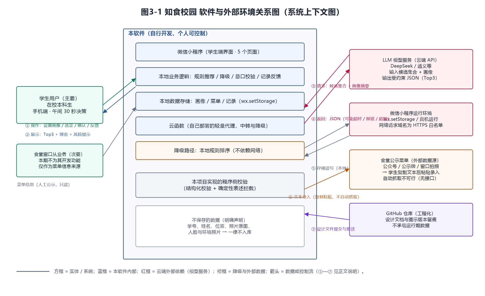
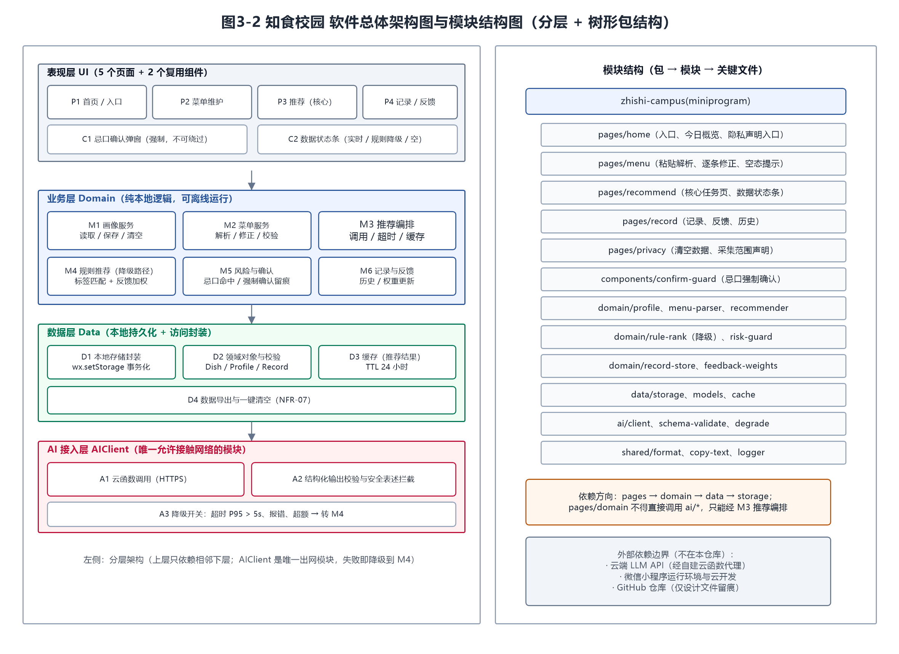
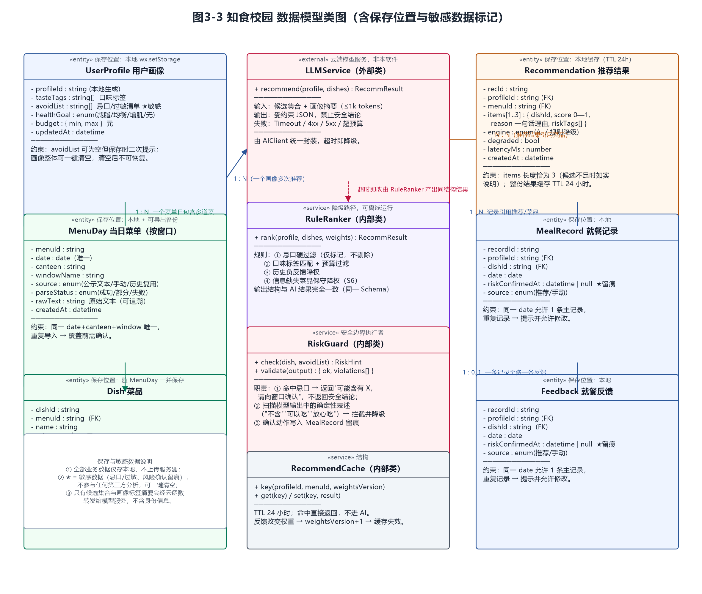
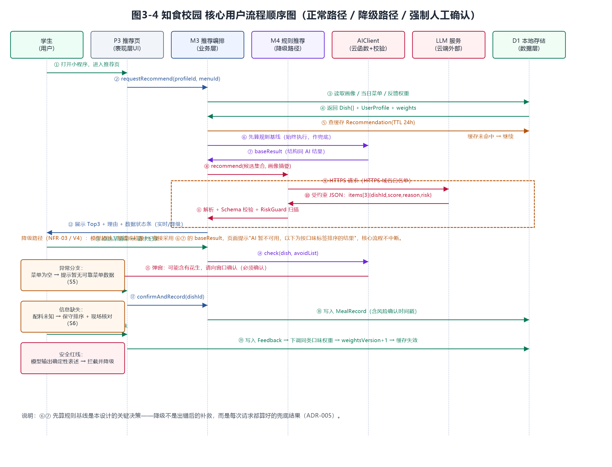
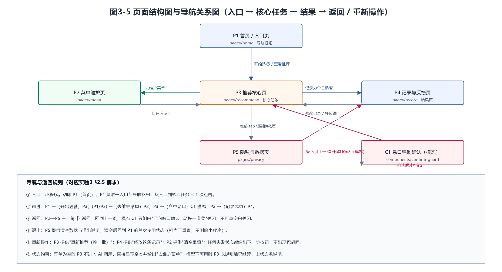
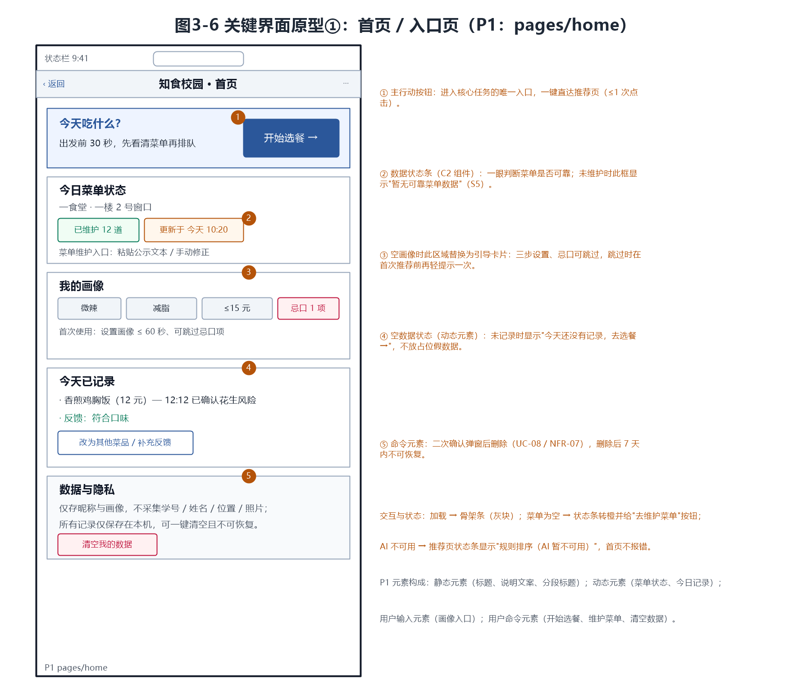
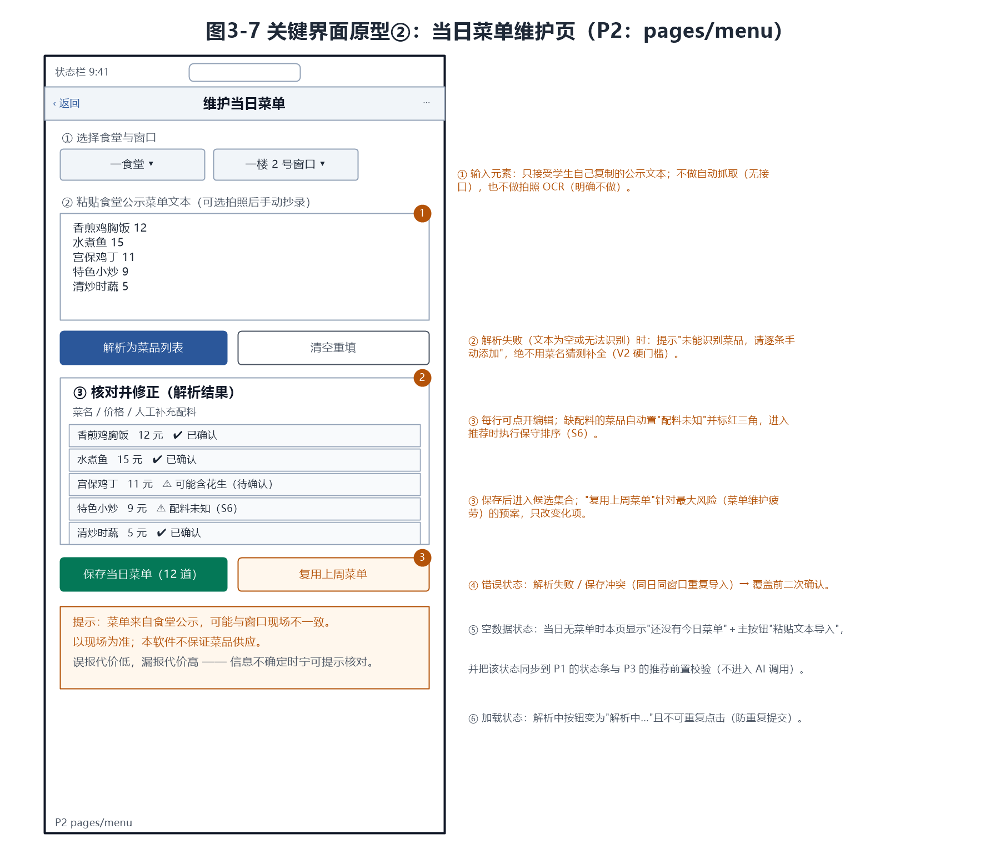
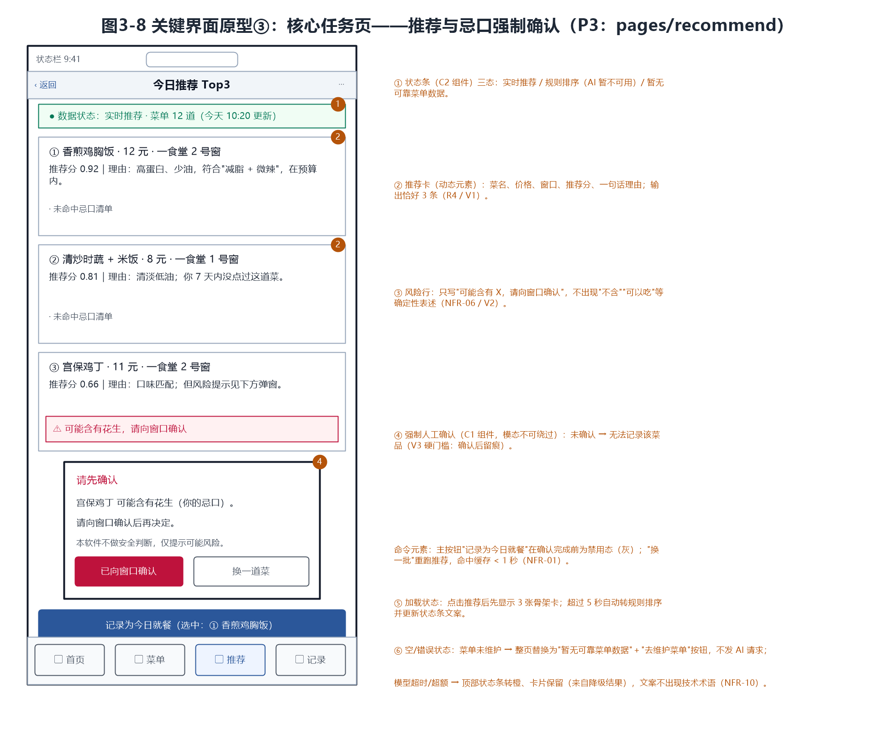
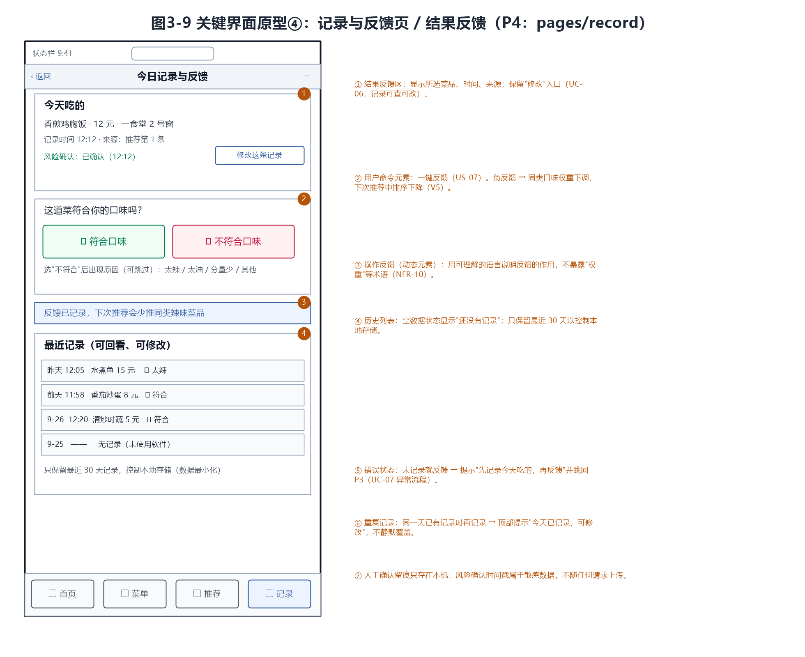
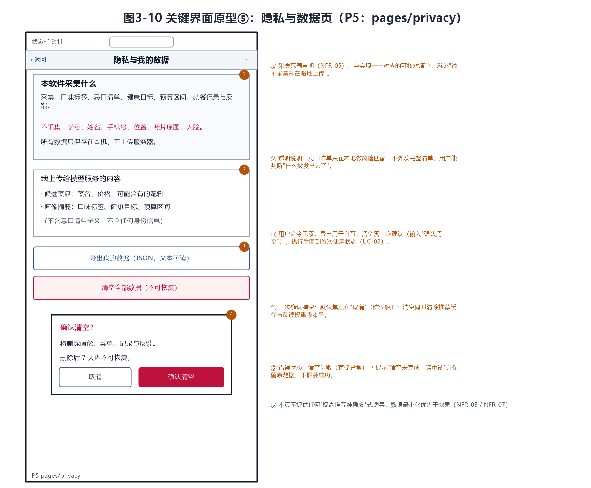

# 实验3：软件架构与界面设计

## 学习通提交说明

- **提交平台：** 只向学习通对应的“实验报告”作业上传一份PDF文件。
- **文件命名：** 班级-学号-姓名-实验3-软件架构与界面设计.pdf。
- **PDF内容：** 需求与设计对应表、技术选型与架构决策、软件与外部环境关系图、总体架构图与模块说明、数据与接口设计、核心流程图、关键界面原型、设计检查记录及仓库版本证据。
- **截止时间：** 以学习通作业设置为准。

## 1. 实验目的

- 把实验2的需求说明转化为可指导后续开发的软件架构、模块边界、数据模型、接口和交互方案。
- 形成与个人能力匹配的技术选型，并保留关键决策依据。
- 完成关键设计，检查需求、架构与界面之间是否一致，为实验4的软件基础功能开发提供设计基线。

## 2. 实验内容

### 2.1 需求输入与设计范围

- 从实验2中选定一条核心用户流程，列出该流程对应的用户故事、功能需求、非功能需求和验收条件，作为本次设计的输入。
- 运用软件工程课程中学习的双向追踪原则，先建立“需求编号—准备完成的设计内容—对应图或文档”对应表，确保每项核心需求都有后续设计任务，后续也能从设计内容追溯到需求来源。
- 初步划分普通软件功能与AI功能的边界，说明哪些任务可以由确定的程序逻辑完成，哪些任务准备交给LLM处理，以及哪些结果需要程序校验或用户确认。本阶段不要求确定RAG、Agent等具体实现方法。

### 2.2 技术选型与架构决策

- 结合已学习的程序设计语言和软件设计约束，从本人熟悉程度、实现成本、框架生态、AI接入、测试和运行环境等方面比较候选方案。比较可以使用简单表格，不要求罗列过多技术或原因。
- 对开发语言与框架、数据保存方式、软件体系结构风格等关键选择编写简短的设计决策说明。设计决策说明也称架构决策记录（ADR），只需写清要解决的问题、考虑过的方案、最终选择、理由和可能的不足。
- 为一项可能影响项目继续开发的关键依赖准备替代方案，例如模型服务、数据库或主要框架。

### 2.3 软件架构与模块设计

- 绘制软件与外部环境关系图（也称简化的系统上下文图），标出用户、个人软件、模型或模型服务以及项目需要访问的外部系统或数据源，说明哪些内容属于本软件、哪些属于外部依赖。模型应根据实际运行和调用方式放在合适位置，并注明使用本地模型还是云端模型服务。图形可以参考已经学习的数据流图，用简单的方框和带名称的箭头表示。
- 绘制软件总体架构图和模块结构图，根据项目特点选择已学习的分层、MVC等体系结构风格，并可使用包图或构件图表示界面、业务、数据和AI能力等模块。两张图可以合并，但要写明各模块的职责和依赖关系。
- 在总体架构图中标明主要数据、调用方向或交互关系，并制作“用户—普通程序—模型—工具职责划分表”，说明核心流程中每一方负责什么以及由谁检查AI结果。

### 2.4 数据、接口与核心流程设计

- 使用已经学习的类图、ER图或其他合适的图形描述核心数据，说明主要数据对象、关键字段、约束和关系，并标明需要保存的数据和敏感数据。
- 设计支撑核心用户流程的主要接口，说明接口由哪个模块提供、由谁调用、用途、输入、输出和失败情况，并至少给出一个正常调用与错误调用示例。
- 选择已经学习的顺序图、活动图、状态图或普通流程图，描述一次核心任务从用户输入到结果反馈的过程，包含正常路径、失败处理以及必要的人工确认点。

### 2.5 界面原型与交互设计

- 绘制页面结构图、导航关系图或顺序图，说明用户如何从软件入口进入核心功能，以及如何在页面之间跳转、返回、退出或重新操作。
- 完成不少于3张关键界面原型图，至少包括首页或入口页、核心任务页和结果页。界面原型是编码前的页面草图，用于确定页面上显示什么以及怎样操作，不要求编写前端代码，可以使用Figma、墨刀、Axure等工具，也可以使用清晰的**手绘图**。
- 结合已经学习的静态元素、动态元素、用户输入元素和用户命令元素，在原型中标注主要信息、输入区域、按钮、输入限制和操作反馈，并补充与项目有关的加载、空数据、错误、重新操作或人工确认状态。

### 2.6 设计一致性检查与版本保存

- 完善2.1建立的需求与设计对应表，补充“架构模块—数据或接口—界面—验收条件”等内容，逐项检查实验2中的核心需求是否已经落实，不需要重新制作一张内容重复的表格。
- 记录检查范围、发现的问题和设计调整；如果未发现问题，应说明检查依据。将架构图、数据模型图、流程图、界面原型图和其他设计文件保存到个人GitHub/Gitee仓库并提交。

## 3. 操作记录

图必须编号，并配有能够说明图中元素和关系的文字。

> **承接说明（与实验2的对应关系）**：本次设计不重新选题。选题、诉求与需求基线全部继承实验2——项目为**知食校园（校园食堂智能选餐助手，微信小程序，学生端）**，核心价值仍是“把今天吃什么，从到窗口前盲目排队变成出发前 30 秒内有依据的决策”。设计输入取自实验2 提交版 v1.0：功能需求 FR-01—FR-08、非功能需求 NFR-01—NFR-12（附录C 表C-1）、用户故事 US-01—US-10（附录A 表A-1）、用例 UC-01—UC-08（附录B 表B-1）、验收示例 V1—V5（表3-7）、场景 S1—S6（表3-3）、需求变化台账 R1—R5（表3-6）。本报告**不引入实验2 之外的新需求**；实验2 中明确不做的功能（实时排队、在线点餐支付、商家端后台、社交拼单、拍照 OCR、多校区适配）在本次设计中同样不出现。
>
> **需求状态声明（重要，与实验2 一致）**：实验2 中标注“访谈A/B/C/W、现场观察”的需求来源**尚未采集**，仍是待验证假设；本次设计承接的是这些假设成立前提下的需求，另有“营养信息不可得”“忌口信息不可得”“高校无菜单公示义务”三条已由公开材料（实验2 3.2.4 材料1—3）支撑，与本设计关系最直接。调研完成后若需求变化，须按表3-1 逐行复核对应设计。

### 3.1 需求与设计对应表（对应 2.1）

#### 3.1.1 设计范围：一条核心用户流程

实验2 已把本学期范围收敛为**唯一一条**核心流程（实验2 图3-1 的核心用户流程图）。本次设计把它拆成 7 个可设计的步骤，作为全部设计工作的锚点：

> **F1** 设置口味与忌口画像 → **F2** 选择当日窗口与候选菜品 → **F3** 获得 AI 推荐 Top3 与理由 → **F4** 选择并记录 → **F5** 反馈 → **F6** 偏好更新；流程中两个**强制人工确认点**：**S3**（可能含忌口/过敏食材）、**S6**（菜品信息缺失）。

表3-1 需求—设计对应表（双向追踪，按 2.1 要求“先建对应表，再开展设计”）

> **术语约定**：**P1—P5** 为界面页面（首页 / 菜单维护 / 推荐核心 / 记录反馈 / 隐私与数据），**C1/C2** 为复用组件（忌口强制确认 / 数据状态条）；**M1—M6** 为业务模块，**D1—D4** 为数据模块，**A1—A3** 为 AI 接入与降级模块（职责见表3-3）。

| 需求编号 | 需求摘要（实验2） | 流程步骤 | 架构模块 | 数据 / 接口 | 界面 | 设计图 | 验收条件 |
| --- | --- | --- | --- | --- | --- | --- | --- |
| FR-01 | 画像设置/修改/清空（忌口可跳过） | F1 | M1 | UserProfile | P1 画像卡、P5 | 图3-2、图3-3 | NFR-08（≤60 秒、≤3 步）、UC-01 |
| FR-02 | 当日菜单维护（粘贴解析 + 人工修正，不编造） | F2 | M2、D2 | MenuDay、Dish、IF-02 | P2 | 图3-2、图3-7 | UC-02（录 10 道、改 3 处）、V2 |
| FR-03 | 查看当日候选菜品 | F2 | M2、D2 | Dish、menuId | P2 列表、P1 数据状态条 | 图3-7 | V2（空菜单如实提示） |
| FR-04 | AI 推荐 Top3（推荐分、一句话理由、风险食材） | F3 | M3、A1、A2、M4 | Recommendation、IF-01 | P3 | 图3-2、图3-4、图3-8 | V1（恰 3 条、字段完整）、V4 |
| FR-05 | 忌口/过敏提示与强制人工确认 | F3′ | M5、A2 | RiskHint、riskConfirmedAt、IF-04 | P3 风险行、C1 | 图3-4、图3-8 | V3（未确认不可记录，硬门槛） |
| FR-06 | 记录今日就餐（可查、可改） | F4 | M6 | MealRecord、IF-07 | P4 | 图3-3、图3-9 | UC-06、NFR-04 |
| FR-07 | 提交就餐反馈（一键符合/不符合） | F5、F6 | M6 | Feedback | P4 | 图3-9 | V5 |
| FR-08 | 清空个人数据（二次确认、不可恢复） | 全程 | M1、D4 | 全部本地数据、IF-08 | P5 | 图3-10 | NFR-07、UC-08 |
| NFR-01 | 推荐 P95 < 5 秒；缓存命中 < 1 秒 | F3 | M3、D3、A3 | 缓存 key / TTL 24h | P3 卡片、C2 数据状态条 | 图3-2、图3-8 | 第11周 30 次实测 P50/P95 |
| NFR-02 | 菜单解析 20 条 < 8 秒 | F2 | M2 | IF-02 | P2 加载态 | 图3-7 | 第8—9周实测 5 次取中位数 |
| NFR-03 | AI 不可用时核心流程可用率 100% | F3 | M4、A3 | IF-01 的 fallback | P3 数据状态条 | 图3-4、图3-8 | V4（模拟超时/断网） |
| NFR-04 | 画像与记录不因重启丢失 | 全程 | D1、D2 | 本地存储封装 | — | 图3-2 | 第4周强制退出重进 |
| NFR-05 | 最小化数据采集 | 全程 | M1、A1 | 画像摘要（不含忌口清单全文） | P5 采集范围声明 | 图3-1、图3-10 | 代码走查 + 抓包核对请求体 |
| NFR-06 | 禁止输出确定性安全结论 | F3′ | A2（`validate()`） | 输出校验规则 | P3 风险行 | 图3-4、图3-8 | 黑名单命中数 = 0，且 30 组样本人工复核全部为否 |
| NFR-07 | 一键清空、7 天内不可恢复 | 全程 | M1、D4 | 清空事务、IF-08 | P5 二次确认弹窗 | 图3-10 | UC-08 功能测试 |
| NFR-08 | 首次设置画像 ≤60 秒、≤3 步 | F1 | P1 | — | P1 引导卡 | 图3-6 | 第14周 5 人走查计时 |
| NFR-09 | 打开到看到推荐 ≤30 秒 | F1—F3 | P1 → P3 导航 | — | 图3-5 导航路径 | 图3-5 | 同上 |
| NFR-10 | 面向用户文案不含技术术语 | 全程 | P1—P5、C2 | 文案词表 | 全部界面 | 图3-6—图3-10 | 5 人复述含义测试 |
| NFR-11 | iOS / Android 真机可用 | 全程 | P1—P5 | — | 全部界面 | — | 第3、17周各测一次 |
| NFR-12 | 模型费用 ≤10 元/月 | F3 | D3、M3 | 缓存 TTL 24h | — | 图3-2 | 第11、17周核对账单 |

> **两个方向都可追**：①**需求 → 设计**：上表 8 条功能需求与 12 条非功能需求全部有模块、数据/接口、界面与设计图落点，不存在“有需求无设计”的条目；②**设计 → 需求**：图3-2 中的每个模块都能追到本表编号（M1→FR-01/FR-08，M2→FR-02/FR-03，M3→FR-04/NFR-01，M4→NFR-03，M5→FR-05/NFR-06，M6→FR-06/FR-07，D1—D4 与 A1—A3 同理），不存在“无需求来源的镀金设计”。用户故事 US-01—US-10 的落点：US-01→FR-03，US-02/US-05→FR-04，US-03→FR-01，US-04→FR-05，US-06→NFR-01 行的 `noveltyHint` 字段，US-07→FR-07，US-08/US-09→FR-02/FR-03，US-10→FR-08；实验2 已删除的 US-X1（实时排队）与 US-X2（社交拼单）在设计中不出现。

> 反向追踪结论：图3-2 中出现的每一个模块（M1—M6、D1—D4、A1—A3）都能追到上表的 FR/NFR 编号，未发现“镀金”设计；同时上表 8 条功能需求与 12 条非功能需求全部有设计落点，未发现“有需求无设计”的条目。逐行核对记录见 3.6 与 `docs/design/design-review.md`。

#### 3.1.3 普通程序与 AI 的边界（初步划分，不涉及 RAG/Agent）

表3-2 确定性程序逻辑与 LLM 的分工

| 任务 | 由谁完成 | 理由 | 结果由谁校验 |
| --- | --- | --- | --- |
| 画像字段校验、存储、清除 | 程序（M1/D1） | 规则明确，无需模型 | 无需 |
| 公示文本 → 菜品列表解析 | 程序（M2） | 只需按行切分菜名与价格；**解析失败宁可让人手动补，也不让模型猜**（V2） | 用户人工核对 |
| 菜单为空 / 菜品信息缺失的判定 | 程序（M2） | 布尔判断 | 无需 |
| 忌口命中检测、强制确认、留痕 | 程序（M5） | 安全相关，必须确定性、可复现、可留痕 | 程序 + **用户确认**（C1） |
| 在候选集合内排序并写出理由 | **LLM**（经 IF-01） | 菜名与口味偏好都是自然语言，规则需穷举词表且无法覆盖新菜名；理由生成必须自然语言 | **程序**（A2：Schema 校验 + 菜名越界检查 + 确定性安全表述拦截） |
| 热量/油盐的模糊表达（区间而非精确值） | **LLM** | 语义化的"清淡/偏油"描述无法用规则穷举 | 程序（文案模板禁止精确数值格式）+ 用户自行判断 |
| 输出是否越界、是否违规 | 程序（A2） | 这是程序侧护栏，不能交给被检查的对象 | 无需 |
| 推荐是否符合口味 | —（无自动判定） | 没有标准答案 | **用户**（接受/换一批/负反馈）+ 30 组人工评测 |
| 规则排序（AI 不可用时） | 程序（M4） | 必须离线可运行、结果可复现 | 程序（与 AI 结果同结构，界面不分支） |

**边界一句话**：**模型只做“在给定集合内挑选并解释”，程序做“校验、降级、留痕与安全拦截”，安全与“能不能吃”的判断权始终在用户与窗口手中。**

### 3.2 技术选型与架构决策（对应 2.2）

#### 3.2.1 候选方案比较

表3-3 技术选型与关键依赖比较表（含替代方案）

| 决策项 | 候选方案（熟悉度 / 实现成本 / 生态 / AI 接入 / 测试与运行环境） | 选择与理由 | 失效时的替代方案与触发判据 |
| --- | --- | --- | --- |
| 客户端形态 | ①**微信小程序**（免安装、原生存储与真机调试，本人已修完小程序课程）；②原生 Android App（需安装、上架门槛高）；③网页 H5（微信内跳转与存储体验不稳定） | **①**：契合“出发前 30 秒”场景，实现成本最低 | 第3周真机测试若失败 → 改用个人主体测试号；表现层与业务层已分离，必要时移植 H5 |
| 前端技术 | ①**原生 WXML/WXSS/JS**；②uni-app / Taro | **①**：页面仅 5 个，跨端收益为零，少一层构建链就少一类排障问题 | 无 |
| 业务逻辑位置 | ①全部在本机（无服务器）；②自建 Node 服务端；③**本机逻辑 + 云函数代理** | **③**：云函数只做转发、托管密钥、超时与费用熔断；规则推荐与安全校验留在本机，可用性最好 | 云函数连续 1 天不可用 → 进入“禁用 AI 模式”（功能降级但流程完整），或改用自建 Node 服务实现同一 IF-01 接口 |
| 数据保存 | ①**本地 wx.setStorage**；②云数据库；③本地 + 云同步 | **①**：NFR-05 数据最小化与 NFR-07“清空且不可恢复”在本地最彻底；无需账号体系 | 用户清缓存导致数据丢失 → 提供“导出 JSON”备份；必要时重设画像（≤60 秒） |
| 模型服务 | ①**商用 LLM API（DeepSeek 等，经自建云函数代理）**；②本地小模型（Ollama）；③不接模型 | **①**：本机无 GPU，本地模型中文语义与理由生成质量不足；单次约 1k tokens，月费用可控在 10 元内（NFR-12） | **最关键依赖**：连续 3 次调用失败或月费用 > 10 元 → ①换同接口的其他厂商模型（业务层只依赖 IF-01 的 JSON 结构，换服务商不改业务代码）；②长期运行在规则推荐版（M4） |
| 推荐算法 | ①纯 LLM；②**LLM + 规则降级**；③纯规则 | **②**：规则路径是 NFR-03/V4 的必做项（实验2 台账 R5），且可先于 AI 开发（ADR-005） | 第11周仍无法稳定返回结构化结果 → 冻结在规则推荐版交付，AI 作为选做，不伪造效果 |
| 体系结构风格 | ①**分层（表现/业务/数据/AI 接入与降级）**；②MVC；③微服务 | **①**：单人单部署单元，微服务属过度设计；MVC 在小程序端无自然落点；分层最契合“AI 必须可替换、可降级” | 无 |
| 版本管理 | ①**GitHub / Gitee 公开仓库**；②本地 git；③网盘 | **①**：作业要求留痕可核验，公开仓库可用 Commit 证明设计演进 | 网络受限时先本地提交，联网后再 `git push` 同步（本次即如此） |

#### 3.2.2 架构决策记录（ADR）

每条按“要解决的问题 → 考虑过的方案 → 最终选择 → 理由 → 可能的不足”编写，编号全文唯一。完整版见 `docs/design/adr.md`。

**ADR-001 采用微信小程序作为客户端形态**
- 问题：用户要在"出发前 30 秒"完成决策，必须零门槛打开；开发资源只有一个人一个学期。
- 方案：①微信小程序；②原生 Android App；③网页 H5。
- 选择：微信小程序。
- 理由：免安装契合场景；本人已有小程序基础；H5 在微信内跳转与存储体验不稳定。
- 不足：依赖微信生态，iOS/Android 交互差异需各测一次（NFR-11）。

**ADR-002 采用“云函数代理 + 本地核心逻辑”的部署形态**
- 问题：小程序直连第三方模型 API 会把密钥暴露在前端包内，且请求域名需 HTTPS 白名单。
- 方案：①前端直连；②自建服务器 + 备案域名；③云函数转发。
- 选择：云函数只做三件事——转发、托管密钥、超时与费用熔断；业务逻辑不下沉。
- 理由：免运维与备案；密钥不进前端；云函数不可用时前端仍可走本地规则路径。
- 不足：多一跳网络（约 100—300 ms）；云函数本身也是外部依赖，须纳入 NFR-03 降级测试。

**ADR-003 数据以本地存储为唯一事实来源**
- 问题：画像、忌口清单、就餐记录存在哪里。
- 方案：①本地存储；②云数据库；③本地 + 云同步。
- 选择：本地。
- 理由：NFR-05 数据最小化与 NFR-07“清空且不可恢复”在本地能彻底做到；无需账号体系，避免收集手机号等身份信息。
- 不足：换设备或清缓存后画像丢失，需重设（首次 ≤60 秒，可接受）。

**ADR-004 模型调用采用“受约束输出 + 本地校验”（本阶段不引入 RAG/Agent）**
- 问题：模型可能返回候选集合外的菜名、编造配料，或给出“可以吃”这类安全结论。
- 方案：①只靠 Prompt 约束；②Prompt + 本地 Schema/安全校验；③引入 RAG 或 Agent 做检索增强。
- 选择：②；本阶段明确**不引入** RAG 与 Agent。
- 理由：候选集合由用户当次提供，本身就是唯一可信上下文，无需外部检索；Agent 的多次工具调用会让费用与时延不可控（与 NFR-01/NFR-12 冲突）；本地校验是确定性程序逻辑，正好兜住模型不可控的部分。
- 不足：本地校验只能发现“菜名越界、字段缺失、确定性表述”三类问题，无法判断推荐是否合口味，这部分靠 V1 人工判定与 30 组评测样本覆盖。

**ADR-005 规则推荐作为“每次都先算好的基线”，而不是出错后的补救**
- 问题：R5 要求“AI 不可用时核心流程可用率 100%”，若降级写在异常分支里，容易出现“超时了但页面已经崩了”。
- 方案：①try/catch 兜底；②每次请求**先算规则基线**，AI 结果作为覆盖；③不做降级。
- 选择：②。
- 理由：顺序反转后，“降级”从异常处理变成一条确定性路径（图3-4 的 ⑥⑦ 步）：AI 超时、报错、超额、输出不合规，都只是“不覆盖基线”，页面永远有 3 条可解释结果；同时规则版可先在第5—7周完成，提前跑通核心流程。
- 不足：每次多一次本地排序计算（可忽略）；规则与 AI 排序不同时用户可能感到“两次结果不一样”，靠 C2 数据状态条标注来源缓解。

**ADR-006 数据最小化：不采集身份与位置，忌口清单不外发**
- 问题：推荐效果与隐私采集如何取舍（NFR-05/NFR-07）。
- 方案：①采集学号/位置以提升推荐；②只采集画像标签并本地保存；③完全不采集。
- 选择：②。
- 理由：学号与位置对“推荐哪道菜”无直接增益，却显著提高泄露风险；③会让软件退化成通用菜单展示，核心价值消失。
- 不足：无位置信息，无法按“离我最近”排序，只能显示窗口名称（与实验2 明确不做的“多校区适配”一致）。

**ADR-007 版本与仓库策略：设计文件与图示同仓留痕**
- 问题：作业要求保存设计文件并给出 Commit 证据。
- 方案：①只提交 PDF；②仓库保存设计文档、图示与渲染脚本。
- 选择：②，仓库 `zhishi-campus`：设计文档在 `docs/design/`、图示在 `docs/report/`、脚本在 `tools/`。
- 理由：图示由脚本生成，改图可复现；被否定的方案与早期设计可通过提交历史留痕。
- 不足：需维护脚本，图形微调要改坐标后重新渲染（已用统一的画布/方框/箭头函数降低改动成本）。

**ADR-008 安全判断不交给模型：AI 只说“可能含有”，确认权在用户**
- 问题：FR-05 要求忌口/过敏提示，误食后果不可接受（实验2 台账 R3）。
- 方案：①AI 判定是否含过敏原并给结论；②AI 只输出“可能含有 X，请向窗口确认” + 强制人工确认；③不做提示。
- 选择：②，并在程序侧加一道 `A2.validate()` 拦截“不含/可以吃/放心吃/没问题”等确定性表述，命中即判输出不合规并改用规则结果。
- 理由：现制菜品无标签，模型无权也无能力判定安全性；划清责任边界后，软件提供的是“提示 + 核对路径”而不是“安全保证”。
- 不足：可能误报，用户久而久之可能忽略提示——因此提示必须写明“请向窗口确认”，并把确认动作留痕（`MealRecord.riskConfirmedAt`）以便事后核查。

**ADR-009 菜单数据只做“文本录入 + 人工修正”，不做自动抓取与拍照 OCR**
- 问题：菜单是核心数据，但学校无接口、窗口不配合上报（实验2 R1 的影响延续）。
- 方案：①爬取后勤公众号；②拍照 OCR 识别菜单牌；③学生复制公示文本粘贴，解析 + 人工修正。
- 选择：③。
- 理由：①不稳定且可能违反网站规则；②OCR 对反光、手写、遮挡的菜单牌识别率不可控，错误菜品比没有菜品更糟；③与“不编造菜品”（V2）一致。
- 不足：录入负担仍在用户身上，菜单可能长期不更新；预案是“同一菜单按周复用 + 只维护变化项”，并在首页数据状态条显示更新时间，**不假装数据是实时的**。

#### 3.2.3 关键依赖的替代方案

### 3.3 软件架构与模块设计（对应 2.3）

#### 3.3.1 软件与外部环境关系图

图3-1 软件与外部环境关系图（系统上下文图）（说明：中间蓝色虚线区为**本软件**，即自行开发、个人可完全控制的部分；左侧绿色为**用户**（主要用户为在校本科生，次要用户食堂窗口从业者本期不为其开发功能）；右侧红色为**云端外部依赖**，其中 LLM 模型服务按实际调用方式放在云端（经自建云函数代理，非本地模型），微信小程序运行环境提供本地存储与真机运行能力；橙色为**降级路径**与**外部数据源**——食堂公示菜单是人工中介的数据来源（学生复制文本后粘贴录入，软件不自动抓取，ADR-009）；紫色为 GitHub 仓库，只承载设计文件与版本留痕，不参与运行期数据流。箭头 ①—⑦ 的数据/控制流含义见下方文字。图片文件 `图3-1-软件与外部环境关系图.png`（2360×1440 像素，300 dpi），渲染脚本 `tools/render-arch.ps1`。）



图中箭头的含义与“哪些属于本软件、哪些属于外部依赖”：

| 箭头 | 方向 | 内容 | 归属 |
| --- | --- | --- | --- |
| ① | 学生 → 软件 | 设置画像、维护菜单、选择菜品、确认风险、提交反馈 | 用户操作 |
| ② | 软件 → 学生 | 展示 Top3、一句话理由、风险提示、数据状态 | 本软件 |
| ③ | 软件 → 模型服务 | 请求：候选集合 + 画像摘要（不含忌口清单全文，≤1k tokens） | 出网请求 |
| ④ | 模型服务 → 软件 | 返回：受约束 JSON；可能超时、报错或超额（对应降级路径） | **外部依赖**（云端，非本地模型） |
| ⑤ | 软件 ↔ 本地存储 | 画像/菜单/记录/缓存读写 | 本软件（本机） |
| ⑥ | 外部菜单 → 软件 | **文本录入**：学生复制公示文本后粘贴，不自动抓取、不做拍照 OCR | **人工中介的外部数据源** |
| ⑦ | 软件 → 仓库 | 设计文件与图示提交推送（非运行期数据） | 工程化，非运行期依赖 |

**外部依赖清单**：①LLM 模型服务（云端 API，经自建云函数代理）；②微信小程序运行环境（含本地存储与网络白名单）；③微信云开发（云函数）；④食堂公示菜单（人工中介）。**本软件**：P1—P5 五个页面、M1—M6 业务模块、D1—D4 数据模块、A1—A3 接入与降级模块（图3-2）。**明确不入库的数据**：学号、姓名、手机号、位置、照片原图、人脸（图3-1 右下角方框，与 NFR-05 一致）。

#### 3.3.2 软件总体架构图与模块结构图

图3-2 软件总体架构图与模块结构图（说明：左半为**分层架构**——表现层 UI、业务层 Domain、数据层 Data、AI 接入与降级控制层；箭头表示依赖方向，上层只能依赖相邻下层，`AIClient` 是唯一允许访问网络的模块，其失败直接回落业务层的 M4 规则路径。右半为**树形包结构**，列出每个包下的关键模块与文件，并给出依赖约束“pages → domain → data → storage，pages/domain 不得直接调用 ai/*”。体系结构风格为分层 + 模块化，理由见 ADR 比较表（未选 MVC：小程序端无自然 Controller 落点；未选微服务：单人单部署单元）。图片文件 `图3-2-软件总体架构图.png`（2360×1720 像素，300 dpi）。）



#### 3.3.3 模块职责与依赖关系

表3-4 模块划分与职责（表现层 / 业务层 / 数据层 / AI 接入与降级控制层）

| 层 | 编号 | 模块 | 职责与对外方法 | 依赖 | 对应需求 |
| --- | --- | --- | --- | --- | --- |
| 表现层 | P1 | 首页/入口页 `pages/home` | 唯一入口；今日菜单状态、画像摘要、今日记录；“开始选餐/维护菜单/清空数据”入口 | M1、M2、M6 | US-01、FR-01、NFR-09 |
| 表现层 | P2 | 菜单维护页 `pages/menu` | 粘贴文本 → 解析 → 逐条核对修正 → 保存；空菜单与解析失败提示 | M2、D1 | FR-02、FR-03 |
| 表现层 | P3 | 推荐核心页 `pages/recommend` | 展示 Top3（卡片/理由/风险行）、数据状态条；记录与“重新推荐”命令；骨架卡与空态 | M3、M4、M5、M6 | FR-04、FR-05、NFR-01/03/10 |
| 表现层 | P4 | 记录与反馈页 `pages/record` | 记录详情、一键反馈、历史列表与修改入口 | M6 | FR-06、FR-07 |
| 表现层 | P5 | 隐私与数据页 `pages/privacy` | 采集范围声明、上传内容说明、导出数据、清空数据（二次确认） | M1、D4 | FR-08、NFR-05/07 |
| 表现层 | C1 | 忌口强制确认组件 | 模态弹窗，只有“已向窗口确认/换一道菜”两个出口；未确认时记录按钮保持禁用 | M5 | FR-05、V3、NFR-06 |
| 表现层 | C2 | 数据状态条组件 | 三态显示（实时推荐 / 本地规则 / 规则降级或数据不足）与菜单更新时间 | M2、M3 | FR-04、NFR-03/10 |
| 业务层 | M1 | 画像服务 | `getProfile / saveProfile / clearAll / exportAll`；字段校验，忌口可空但保存时二次提示 | D1、D2 | FR-01、FR-08 |
| 业务层 | M2 | 菜单服务 | `parseMenus / saveMenuDay / listDishes / validateMenu`；解析只依据文本行，**不猜菜名、不补配料** | D1、D2 | FR-02、FR-03、V2 |
| 业务层 | M3 | 推荐编排 | `recommend(profileId, menuId)`：前置校验 → 查缓存 → **先算规则基线** → 调 A1（≤5 秒）→ 交 A2 校验 → 违规则丢弃 AI 结果保留基线 → 写缓存 → 返回统一结构 | M4、A1、A2、D3 | FR-04、NFR-01/03/12 |
| 业务层 | M4 | 规则推荐（降级路径） | `rank(profile, dishes, weights)`：忌口命中只标记不剔除 → 口味标签匹配 + 预算过滤 → 负反馈降权 → 近 7 天吃过的菜降权并置 `noveltyHint=false` → 信息缺失保守降权 | D2 | NFR-03、V4、R5 |
| 业务层 | M5 | 风险与确认 | `check(dish, avoidList)` 返回“可能含有 X，请向窗口确认”；`confirm(dishId)` 写入确认时间戳；`isConfirmed()` 控制记录按钮 | D1、D2 | FR-05、V3 |
| 业务层 | M6 | 记录与反馈 | `record / updateRecord / listRecords / submitFeedback`；负反馈下调同类口味权重并令 `weightsVersion+1`（缓存失效） | D1、D2、D3 | FR-06、FR-07、V5 |
| 数据层 | D1 | 本地存储封装 | 统一封装 `wx.setStorage`，命名空间 `zs:profile` / `zs:menu:*` / `zs:record` / `zs:feedback` / `zs:cache`；写入失败抛可识别错误；按命名空间批量清空 | wx 本地存储 | NFR-04、NFR-07 |
| 数据层 | D2 | 领域对象与校验 | 六个领域对象的结构定义与字段校验（见表3-6、图3-3） | D1 | FR-01—FR-07 |
| 数据层 | D3 | 推荐结果缓存 | key = `hash(profileId, menuId, weightsVersion)`，TTL 24 小时；命中 <1 秒返回；写入时清理过期 key 与落后的版本缓存 | D1 | NFR-01、NFR-12 |
| 数据层 | D4 | 导出与一键清空 | 导出全部业务数据为可读 JSON；清空走一次性事务，失败回滚并提示“清空未完成，请重试” | D1、D2 | FR-08、NFR-07 |
| AI 接入与降级控制层 | A1 | 云函数调用 | 组装 IF-01 请求（≤1k tokens），5 秒超时、最多重试 1 次；记录时延与 token 消耗 | 云函数 | FR-04、NFR-01/12 |
| AI 接入与降级控制层 | A2 | 结构化校验与安全表述拦截 | Schema 校验（字段齐全、恰 3 条、`dishId` 必须在候选集合内）+ 确定性安全表述黑名单扫描 | M5 | FR-04、FR-05、NFR-06 |
| AI 接入与降级控制层 | A3 | 降级开关 | 维护调用状态与费用累计；超时/HTTP 错误/超预算/连续 3 次失败 → 关闭 AI，回到 M4 基线，并把原因交给 C2 文案 | M3、M4 | NFR-03、V4 |

> 依赖方向：`pages → domain → data → storage`；`pages` 与 `domain` **不得直接调用 `ai/*`**，只能经 M3 推荐编排（这也是图3-4 把 AIClient 画成唯一出网模块的原因）。

#### 3.3.4 用户—普通程序—模型—工具职责划分表

表3-5 用户—普通程序—模型—工具职责划分表

| 环节 | 用户（学生） | 普通程序（本地确定性逻辑） | 模型（LLM） | 工具 / 外部系统 | **谁检查 AI 结果** |
| --- | --- | --- | --- | --- | --- |
| 画像设置 | 填写口味/忌口/目标/预算，可跳过忌口 | M1/D1 校验、存储、清除 | 不参与 | 微信本地存储 | 无需（无 AI 参与） |
| 菜单维护 | 复制公示文本、修正错漏 | M2 解析、标记“配料未知”、拒绝补全 | 不参与 | 食堂公示（人工中介） | 无需（无 AI 参与） |
| 推荐排序 | 接受或换一批 | M3/M4 先算规则基线、缓存、超时控制 | 在候选集合内挑 3 条并写出理由 | 云函数、模型 API | **程序**：A2 Schema 校验 + 菜名越界检查，越界即丢弃 |
| 热量与油盐标注 | 阅读区间而非精确值 | 文案模板限定“估算区间”格式 | 给出区间与不确定度 | — | **程序 + 用户**：程序禁止精确数值格式，用户自行判断 |
| 忌口/过敏（S3） | **决定是否到窗口核对并确认** | M5 命中检测、强制确认、留痕 | 只被允许说“可能含有 X” | 窗口工作人员（最终判断者） | **程序** A2 拦截确定性表述 + **用户** 人工确认（C1） |
| 信息缺失（S6） | 现场核对菜品 | M2 标记 `infoComplete=false`；M4 保守降权 | 不得补全配料 | 窗口 | **程序**：V2 硬门槛——输出中不得出现未提供过的配料 |
| 记录 | 选择并确认记录 | M6 写入记录、重复记录提示 | 不参与 | 本地存储 | 无需 |
| 反馈 | 一键“符合/不符合” | M6 权重下调、缓存失效 | 下次推荐使用更新后的偏好 | — | 程序：V5 用两次推荐对比验证 |
| 数据清空 | 二次确认后执行 | M1/D4 事务删除、失败回滚 | 不参与 | 本地存储 | 无需 |

**结论**：模型只负责“在给定集合内排序 + 生成自然语言理由”；**所有安全相关输出由程序校验、由用户确认**，与实验2 4.4“AI 必要但不越界”的结论一致。

### 3.4 数据、接口与核心流程设计（对应 2.4）

#### 3.4.1 数据模型（类图）

图3-3 数据模型类图（说明：六个领域对象——UserProfile 用户画像、MenuDay 当日菜单、Dish 菜品、Recommendation 推荐结果、MealRecord 就餐记录、Feedback 就餐反馈；另有两个内部服务类 `RuleRanker`（降级规则排序）与 `RiskGuard`（安全边界执行者）和一个外部类 `LLMService`（云端模型服务，非本软件）。图中每个类标注了**保存位置**（全部为本机，`wx.setStorage`），★ 标记为**敏感数据**（忌口/过敏清单、风险确认留痕）；连线标注了 1:N 与 1:0..1 关系及含义。图片文件 `图3-3-数据模型类图.png`（2360×1800 像素，300 dpi）。完整字段与约束见 `docs/design/data-model.md`。）



表3-6 主要数据对象、关键字段与约束摘要（完整版见 `docs/design/data-model.md`）

| 对象 / 接口 | 关键字段或输入输出 | 主要约束 | 保存位置 | 敏感 |
| --- | --- | --- | --- | --- |
| UserProfile 用户画像 | profileId、tasteTags、avoidList、healthGoal、budget、updatedAt | 忌口可为空但保存时二次提示；可一键清空 | 本地 | avoidList **是** |
| MenuDay 当日菜单 | menuId、date、canteen、windowName、source、parseStatus、rawText | `date+canteen+window` 唯一；只保留最近 30 天 | 本地 | 否 |
| Dish 菜品 | dishId、menuId、name、price、ingredients、allergenTags、tasteTags、infoComplete | `ingredients=null` ⇒ `infoComplete=false`，禁止推断补全 | 本地 | allergenTags **是** |
| Recommendation 推荐结果 | recId、weightsVersion、items[1..3]{dishId,score,reason,riskTags,noveltyHint}、engine、degraded、latencyMs | 候选 ≥3 时恰 3 条；`dishId` 必须来自候选集合；缓存 TTL 24 小时 | 本地缓存 | 否 |
| MealRecord 就餐记录 | recordId、dishId、date、source、riskConfirmedAt | 同一天允许多条记录；确认动作留痕 | 本地 | riskConfirmedAt **是** |
| Feedback 就餐反馈 | feedbackId、recordId、result、reason、weightDelta | 一条记录至多一条反馈；负反馈仅下调同类口味权重 | 本地 | 否 |

**ER 关系**：`UserProfile 1—N Recommendation`、`UserProfile 1—N MealRecord`、`MenuDay 1—N Dish`、`Recommendation N—N Dish`、`Dish 1—N MealRecord`、`MealRecord 1—0..1 Feedback`。所有外键均为**逻辑外键**（本地 JSON 存储不做级联），删除与清空由 D4 的事务统一处理，避免悬空引用。

**保存与敏感数据策略**：①全部业务数据仅保存在本机，不上传服务器；②只有“候选菜品 + 画像标签摘要”经云函数转发给模型服务，**不含忌口清单全文、不含任何身份信息**；③忌口/过敏与确认留痕不参与任何统计；④所有数据可一键清空且 7 天内不可恢复；⑤学号、姓名、手机号、位置、照片原图**完全不采集**。

#### 3.4.2 接口设计

本项目接口分两类：**对外网络接口只有 1 个**（IF-01，经自建云函数代理调用模型服务）；其余为**本地函数接口**（模块之间的调用，不涉及序列化，列出用于界定模块边界与失败行为）。

表3-7 主要接口一览（IF-01 为唯一对外接口，其余为本地函数接口）

| 编号 | 接口 | 提供模块 | 调用方 | 用途 | 输入 → 输出 | 失败情况 |
| --- | --- | --- | --- | --- | --- | --- |
| IF-01 | `POST /recommend` | 自建云函数（由 M3 调用） | M3 推荐编排 | 在候选集合内挑 3 道并给理由 | 候选 `dishes[]` + 画像摘要 → `{items[3], engine, degraded, latencyMs}` | 超时 / 429 / 500 / 输出不合规 / 请求过大 → 采用规则基线 |
| IF-02 | `parseMenus(rawText)` | M2 | P2 | 公示文本 → 菜品列表 | 多行文本 → `{dishes[], parseStatus, failedLines[]}` | 解析失败 → 提示手动添加，**不编造菜名** |
| IF-03 | `rank(profile, dishes, weights)` | M4 | M3 / P3 | AI 不可用时的规则排序 | 画像 + 菜品 + 权重 → 与 IF-01 同结构 | 无外部依赖，不会失败 |
| IF-04 | `check(dish, avoidList)` | M5 | M3 / P3 | 忌口命中检测与提示文案 | 菜品 + 忌口清单 → `{hit, hint, allowRecord}` | 信息缺失 → “配料未知，请现场核对” |
| IF-05 | `validate(aiOutput)` | A2 | M3 | 程序侧校验 AI 输出 | AI 原始输出 → `{ok, violations[]}` | 不抛异常，返回违规清单供 M3 决定是否丢弃 |
| IF-06 | `recommend(profileId, menuId)` | M3 | P3 | 核心推荐编排 | 画像 ID + 菜单 ID → 统一 Recommendation 或空态标记 | 菜单为空 → 不发网络请求；AI 失败 → 规则基线 |
| IF-07 | `submitFeedback(feedback)` | M6 | P4 | 保存反馈并更新权重 | 反馈对象 → `{weightsVersion}` | 无对应记录 → 错误码，引导先记录 |
| IF-08 | `clearAll()` | M1/D4 | P5 | 清空全部本地数据 | — → `{ok}` | 失败即回滚，提示“清空未完成，请重试” |

**接口的关键约束**（与 NFR 对应）：IF-01 超时 5 秒（NFR-01）、输入约 1k tokens（NFR-12）、输出禁止确定性安全结论（NFR-06）、`dishId` 必须在候选集合内（ADR-004）；IF-02 解析 20 条文本 < 8 秒（NFR-02）；IF-04 输出不得出现“不含/没问题/可以吃”。
#### 3.4.3 接口调用示例（一个正常、一个错误）

**正常调用示例**（IF-01 返回合规结果）
请求：
```json
POST /recommend
{
  "dishes": [
    { "dishId": "d1", "name": "香煎鸡胸饭", "price": 12, "ingredients": ["鸡胸肉","米饭","西兰花"], "tasteTags": ["清淡"] },
    { "dishId": "d2", "name": "宫保鸡丁", "price": 11, "ingredients": null, "allergenTags": ["可能含花生"], "tasteTags": ["辣"] },
    { "dishId": "d3", "name": "清炒时蔬", "price": 5, "ingredients": ["青菜"], "tasteTags": ["清淡"] },
    { "dishId": "d4", "name": "水煮鱼", "price": 15, "ingredients": ["草鱼","辣椒"], "tasteTags": ["辣"] }
  ],
  "profileSummary": {
    "tasteTags": ["微辣"], "healthGoal": "减脂",
    "budget": { "min": 8, "max": 15 }, "avoidCount": 1,
    "recentNegativeTasteTags": ["重辣"]
  },
  "topN": 3
}
```
响应（HTTP 200）：
```json
{
  "items": [
    { "dishId": "d1", "score": 0.92, "reason": "高蛋白、少油，符合你的减脂目标，在预算内。", "riskTags": [], "noveltyHint": true },
    { "dishId": "d3", "score": 0.81, "reason": "清淡低油，你最近 7 天没有点过这道菜。", "riskTags": [], "noveltyHint": true },
    { "dishId": "d2", "score": 0.66, "reason": "口味与你的偏好接近，但配料信息缺失，建议到窗口确认。", "riskTags": ["可能含有花生"], "noveltyHint": false }
  ],
  "engine": "ai", "degraded": false, "partial": false, "latencyMs": 2380
}
```
程序侧处理：Schema 校验通过 → `A2.validate()` 未发现确定性表述 → 写缓存（key 含 `weightsVersion`）→ P3 渲染三张卡；其中 `d2` 命中忌口，记录按钮先置为禁用，弹出 C1 强制确认，确认后写入 `riskConfirmedAt` 才允许记录。

**错误调用示例（超时 / 超额 → 降级）**
请求同上；云函数返回（HTTP 429，或客户端 5 秒超时无响应）：
```json
{ "error": { "code": "RATE_LIMIT", "message": "模型服务繁忙或已超出本月预算" } }
```
程序侧处理（对应图3-4 的降级路径）：
1. A3 记录失败并更新降级状态（连续 3 次 → 关闭 AI，进入长期降级模式）；
2. M3 丢弃 AI 分支，**直接返回第 ③ 步已算好的规则基线**（无需重算）；
3. C2 数据状态条转橙，文案：“AI 暂不可用，以下为按口味标签排序的结果”；
4. 结果结构不变（`engine:"rule"`、`degraded:true`），**界面渲染逻辑不分支**；
5. 核心流程不中断：仍可查看 3 条推荐、完成忌口确认、记录与反馈（NFR-03 / V4）。

#### 3.4.4 核心任务流程（顺序图）

图3-4 核心用户流程顺序图（说明：7 条生命线——学生、P3 推荐页、M3 推荐编排、M4 规则推荐、AIClient（云函数 + 校验）、LLM 服务（云端外部）、D1 本地存储；①—⑳ 条消息覆盖“读画像/菜单 → 查缓存 → **先算规则基线** → 调 AI → 校验 → 展示 → 忌口强制确认 → 记录留痕 → 反馈并更新权重”的完整过程。虚线框为**降级路径**（超时、报错、超额时不覆盖基线，改用规则结果并提示），左侧三个方框为异常与安全分支（菜单为空 S5、配料未知 S6、模型输出确定性表述被拦截）。图片文件 `图3-4-核心流程顺序图.png`（2360×1800 像素，300 dpi）。）



**数据状态条（C2）的配色约定**：绿 = 实时 AI 结果或已确认（正常）；灰 = 本地规则结果（正常，非错误）；橙 = 规则降级或数据不足（需说明原因）；红 = 强制确认或错误（必须处理）。
**正常路径**：①打开推荐页 → ②请求推荐 → ③读画像/菜单/权重 → ④返回 → ⑤查缓存（未命中）→ ⑥**先算规则基线** → ⑦得到兜底结果 → ⑧调 AI → ⑨HTTPS 请求 → ⑩返回受约束 JSON → ⑪解析 + Schema 校验 + 风险扫描 → ⑫展示 Top3、理由与数据状态 → ⑬点选菜品 → ⑭检测忌口 → ⑮**强制确认弹窗** → ⑯用户向窗口核对后确认 → ⑰确认并记录 → ⑱写入记录（含确认时间戳）→ ⑲反馈“符合/不符合” → ⑳更新权重、版本号 +1、缓存失效。

**失败处理与人工确认点**：模型超时/报错/超额 → 采用基线并明确提示（不静默失败）；菜单为空 → 前置校验直接给空态、不发起 AI 请求；配料未知 → “配料未知，请现场核对”且保守降权；模型输出含确定性安全结论 → A2 拦截、改用语料更保守的规则结果。三处人工确认均留痕（忌口确认时间戳、`infoComplete`、画像 `updatedAt`）。

### 3.5 界面原型与交互设计（对应 2.5）

#### 3.5.1 页面结构与导航关系

图3-5 页面结构图与导航关系图（说明：方框为页面与组件，箭头为导航方向。P1 首页是唯一入口与导航枢纽，核心任务 ≤1 次点击可达；P2 菜单维护、P3 推荐核心、P4 记录反馈、P5 隐私与数据为功能页；C1 忌口强制确认是**模态**组件，只能由“已向窗口确认”或“换一道菜”关闭，不能点空白关闭。图下方给出入口/前进/返回/退出/重新操作五类规则与状态约束。图片文件 `图3-5-页面导航关系图.png`（2360×1280 像素，300 dpi）。）



**导航规则**：①**入口**：小程序启动即 P1，P1 为唯一入口与导航枢纽，从入口到核心任务 ≤1 次点击（对应 NFR-09 的 30 秒路径 = 打开 → 点“开始选餐” → 看到推荐）；②**前进**：P1→P3、P1/P3→P2、P3→（命中忌口）C1 模态、P3→（记录成功）P4、P1→P5；③**返回**：P2—P5 左上角“‹ 返回”回到上一页，模态 C1 只能通过两个按钮关闭；④**退出**：P5 提供清空数据与退出说明，清空后回到 P1 的首次使用状态（相当于重置，不删除小程序）；⑤**重新操作**：P3 提供“重新推荐（换一批）”、P4 提供“修改这条记录”、P2 提供“清空重填”，**任何失败状态都必须给出下一步按钮，不出现死胡同**；⑥**状态约束**：菜单为空时 P3 不进入 AI 调用、直接显示空态并给“去维护菜单”；模型不可用时 P3 以规则结果继续，由数据状态条说明。

#### 3.5.2 关键界面原型（5 张，含 3 张必做页）

图3-6 关键界面原型①：首页/入口页 P1（说明：手绘风格线框，右侧 ①—⑤ 为元素标注。**静态元素**：标题“今天吃什么？”、说明文案、分段标题、底部 4 项 tab；**动态元素**：菜单状态（已维护 12 道 / 更新于今天 10:20）、今日记录摘要；**用户输入元素**：画像设置入口；**用户命令元素**：“开始选餐 →”“维护菜单”“清空我的数据”。状态：菜单未维护时状态条转橙并给“去维护菜单”；加载时显示骨架条；未记录时显示“今天还没有记录，去选餐 →”，不放占位假数据。图片文件 `图3-6-界面原型-首页.png`（1800×1520 像素，300 dpi）。）



图3-7 关键界面原型②：当日菜单维护页 P2（说明：**用户输入元素**为“选择食堂/窗口”“粘贴公示菜单文本”输入框（只接受学生复制的公示文本，不做自动抓取与拍照 OCR）；**动态元素**为逐条解析结果与“已确认/待确认”标记（缺配料的菜品标红三角，进入推荐时执行保守排序）；**命令元素**为“解析为菜品列表”“保存当日菜单”“复用上周菜单”“清空重填”。输入限制：解析失败时提示“未能识别菜品，请逐条手动添加”，**绝不猜测补全菜名**；加载时按钮变“解析中…”且不可重复点击；同日同窗口重复导入时覆盖前二次确认。图片文件 `图3-7-界面原型-菜单维护页.png`（1800×1520 像素，300 dpi）。）



图3-8 关键界面原型③：核心任务页——推荐与忌口强制确认 P3（说明：顶部为**数据状态条 C2**（三态：实时推荐=绿 / 本地规则=灰 / 规则降级或数据不足=橙）；三张推荐卡为**动态元素**，展示菜名、价格、窗口、推荐分与一句话理由，输出恰为 3 条；命中忌口的推荐卡出现红色风险行，文案固定为“可能含有 X，请向窗口确认”，绝不出现“不含/可以吃”；**强制人工确认弹窗 C1 为模态**，只有“已向窗口确认”与“换一道菜”两个出口，未确认时“记录为今日就餐”按钮保持禁用——“换一道菜”不记录并保留推荐列表，属于重新操作路径；**命令元素**为主按钮与“重新推荐（换一批）”。加载状态显示 3 张骨架卡，超过 5 秒自动转规则排序并更新状态条；菜单未维护时整页替换为空态并给“去维护菜单”，不发起 AI 请求。图片文件 `图3-8-界面原型-推荐核心页.png`（1960×1600 像素，300 dpi）。）



图3-9 关键界面原型④：记录与反馈页（结果页）P4（说明：结果区展示所选菜品、价格、窗口、记录时间、来源与**风险确认留痕**，并提供“修改这条记录”；反馈区为**用户命令元素**——一键“👍 符合口味 / 👎 不符合口味”，选“不符合”后可填原因（可跳过）；操作反馈以可理解语言说明作用（“下次推荐会少推同类辣味菜品”），**不暴露“权重”等技术术语**（NFR-10）；历史列表展示最近记录与“无记录”状态，只保留最近 30 天以控制本地存储。错误状态：未记录就反馈 → 提示“先记录今天吃的，再反馈”并跳回 P3；同一天重复记录 → 顶部提示“今天已记录，可修改或继续新增”，不静默覆盖。图片文件 `图3-9-界面原型-记录反馈页.png`（1960×1600 像素，300 dpi）。）



图3-10 关键界面原型⑤：隐私与数据页 P5（说明：**静态元素**为“采集什么/不采集什么”的可核对清单（不采集学号、姓名、手机号、位置、照片原图、人脸）与“上传给模型服务的内容”说明（只上传候选菜品与画像标签摘要，不含忌口清单全文）；**用户命令元素**为“导出我的数据（JSON）”与“清空全部数据”；清空走**二次确认弹窗**，默认焦点在“取消”以防误触，确认后删除画像、菜单、记录、反馈与缓存且 7 天内不可恢复；失败时不假装成功，提示“清空未完成，请重试”并保留原数据。本页不提供任何“提高推荐准确度”式的采集诱导（数据最小化优先于效果）。图片文件 `图3-10-界面原型-隐私与数据页.png`（1840×1520 像素，300 dpi）。）



表3-8 原型元素与状态覆盖自查表

| 要求覆盖的元素/状态 | P1 首页 | P2 菜单页 | P3 推荐页 | P4 记录页 | P5 隐私页 |
| --- | --- | --- | --- | --- | --- |
| 静态元素（标题、说明、分区） | ✔ | ✔ | ✔ | ✔ | ✔ |
| 动态元素（随数据变化） | 菜单状态、今日记录 | 解析结果与确认标记 | 3 张推荐卡、数据状态条 | 记录详情、历史列表 | 上传内容说明 |
| 用户输入元素 | 画像设置 | 文本粘贴、逐条修正 | （选择菜品） | 反馈原因（可跳过） | （二次确认输入） |
| 用户命令元素 | 开始选餐、维护菜单、清空数据 | 解析、保存、复用、清空重填 | 记录、重新推荐、确认/换一道菜 | 反馈、修改记录 | 导出、清空 |
| 加载状态 | 骨架条 | “解析中…”且防重复点击 | 3 张骨架卡 + 超时转降级 | — | — |
| 空数据状态 | “今天还没有记录” | “还没有今日菜单” | “暂无可靠菜单数据”+去维护菜单 | “还没有记录” | — |
| 错误状态 | 状态条转橙 | 解析失败提示手动添加 | 状态条转橙、保留规则结果 | “先记录再反馈” | “清空未完成，请重试” |
| 重新操作 | — | 清空重填 | 换一批 | 修改这条记录 | — |
| 人工确认 | — | 重复导入覆盖前确认 | **忌口强制确认（模态 C1）** | — | 清空二次确认 |

**状态配色约定（统一说明）**：绿 = 实时 AI 结果或已确认（正常）；灰 = 本地规则结果（正常，非错误）；橙 = 规则降级或数据不足（需说明原因）；红 = 强制确认或错误（必须处理）。

### 3.6 设计一致性检查与版本保存（对应 2.6）

#### 3.6.1 检查范围与方法

| 项 | 内容 |
| --- | --- |
| 检查对象 | 表3-1—表3-11、图3-1—图3-10、ADR-001—009、IF-01—IF-08 |
| 检查方法 | ①**需求→设计**：把表3-1 每一行拿到图中与原型里找落点，找不到即记问题；②**设计→需求**：把图3-2 的每个模块、原型的每个元素反向追到需求编号，追不到即记“无依据设计”；③**跨图一致**：模块编号、字段名、按钮文案在两张以上图中是否同义同形；④**验收复核**：用 V1—V5 逐条套设计，看设计是否足以判定通过 |
| 未检查项 | 真机运行效果、实际时延与费用（属实验4 与第11周实测范围） |

#### 3.6.2 检查发现与设计调整

表3-9 设计一致性问题与调整记录

| 编号 | 发现的问题 | 类型 | 检查依据 | 设计调整 | 状态 |
| --- | --- | --- | --- | --- | --- |
| D1 | P1 画像摘要显示“忌口 1 项”，与“忌口清单不外发、不显露”的最小化边界模糊 | 隐私边界不一致 | 图3-6 ③ 与 NFR-05 | 数值只在本机显示；上传摘要中改为 `avoidCount` 字段且不含清单内容，并在 IF-01 明确其含义 | 已调整 |
| D2 | 缓存以 `weightsVersion` 为 key，但未设计旧 key 清理，长期使用会累积无效缓存 | 设计缺口 | 图3-2 D3 与 ADR-005 | D3 增加“写入时清理过期 key 与 `weightsVersion` 落后的同 menuId 缓存” | 已调整 |
| D3 | 顺序图只画了 S3 忌口确认，未画 S6 信息缺失路径，易被误读为“信息缺失只影响排序” | 图间不一致 | 图3-4 与 图3-1、图3-8 | 顺序图下方补注三类异常分支（菜单为空 / 配料未知 / 输出不合规），并把 S6 的保守降权写入 M4 | 已调整 |
| D4 | IF-01 规定候选超过 20 道时截断，但未定义截断时的用户可见行为 | 接口设计不完整 | IF-01 错误表 413 行 | 明确截断规则（按预算与匹配度取前 20 道），并在 C2 数据状态条提示“本次仅对前 20 道排序”，不静默截断 | 已调整 |
| D5 | 数据模型中“同一天允许 1 条主记录”与原型的“今日记录 + 历史列表”冲突（一天吃两餐时无处存放） | 数据模型与界面不一致 | 图3-3 MealRecord 约束 与 图3-9 ① | 改为**同一天允许多条记录**（按时间排序），重复记录提示“今天已记录，可修改或继续新增”；反馈仍限定“一条记录至多一条反馈” | 已调整 |
| D6 | 界面原型未给状态配色与图例，读者无法判断“绿色状态条”代表什么 | 表达缺失 | 图3-7—图3-6 | 统一三态配色（绿=实时 AI / 灰=本地规则 / 橙=规则降级或数据不足 / 红=强制确认或错误）并在 3.5 说明 | 已调整 |
| D7 | US-06“推荐没吃过的菜”在数据模型与界面中只有一句文案，没有可核验字段 | 需求未落实 | 表3-1 的 US-06 行 与 图3-3 | Recommendation.items 增加 `noveltyHint: bool`（近 7 天未点过），M4 规则④与 P3 卡片标签均引用该字段 | 已调整 |
| D8 | A2 的“确定性表述黑名单”不可能穷举，写成“零遗漏”属过度承诺 | 验收不可判定 | 图3-4 安全红线 与 NFR-06 | 验收口径改为：①黑名单命中数 = 0（机器可判定）；②30 组样本人工复核“是否给出安全性结论”全部为“否”，两者都达标才算通过 | 已调整 |
| D9 | 模块名“AI 接入层 AIClient”内含 A3 降级开关，而 A3 不访问网络，命名与职责不符 | 命名一致性 | 图3-2 右下分区 | 该层更名为“AI 接入与降级控制层（A1 调用 / A2 校验 / A3 降级开关）”，并注明 A3 与 M3 共用状态 | 已调整 |
| D10 | 底部 tab 只有 4 项，P5 只能从 P1 进入，但导航图未标明该路径 | 导航不完整 | 图3-5 与 图3-10 | 导航图补 P1→P5 进入路径与说明（不影响 NFR-09 的 30 秒路径） | 已调整 |
| D11 | 图3-1 把“食堂公示菜单”画成外部数据源并有箭头指向软件，容易被读成“软件自动抓取” | 表达歧义 | 图3-1 ⑥ 与 ADR-009 | 箭头标注改为“文本录入（复制粘贴，不自动抓取）”，并明确该依赖是**人工中介**而非接口 | 已调整 |
| D12 | 早期草稿曾计划让模型解析菜单，与“解析失败不编造”的要求冲突（本次检查确认最终设计未调用模型） | 三方一致性 | FR-02、IF-02、ADR-009 | 在设计中明确写入“菜单解析不使用模型”，防止后续实现时被“顺手加上 AI” | 已确认 |

#### 3.6.3 未发现问题项的检查依据

| 检查项 | 结论 | 依据 |
| --- | --- | --- |
| 核心流程 F1—F6 每步都有页面与模块承接 | 未发现问题 | 表3-1 的七个流程步骤全部有页面、模块、数据与验收对应；图3-5 可完整走通该流程 |
| 是否存在无需求来源的模块（镀金设计） | 未发现问题 | 图3-2 的 M1—M6、D1—D4、A1—A3 均可追到 FR/NFR 编号（表3-1 的反向追踪说明） |
| 是否存在有需求但无设计承接的条目 | 未发现问题 | 8 条功能需求与 12 条非功能需求全部有落点；US-X1/X2 已在实验2 删除，设计中有意留空 |
| V1—V5 是否都能用本设计判定 | 未发现问题 | V1（IF-01 结构 + 恰 3 条）、V2（IF-02 不编造 + A2 校验）、V3（M5 + C1 + 留痕字段）、V4（ADR-005 基线 + C2 文案）、V5（M6 权重下调 + D3 缓存失效）逐条有设计落点 |
| 强制人工确认点是否都可留痕 | 未发现问题 | 忌口确认 → `MealRecord.riskConfirmedAt`；信息缺失 → `Dish.infoComplete` + P3 提示；首次设画像 → `UserProfile.updatedAt` |
| 是否引入了实验2 之外的新需求 | 未发现问题 | 全文需求编号均来自实验2；本次新增的 `noveltyHint` 字段是落实既有 US-06 的实现手段，不是新需求 |

**本次检查的局限**：①检查是**书面推演**，未经真机与真实模型输出验证，图3-4 的时延与降级时序属预期行为，需在第11—12周用实测数据回填；②跨图文案一致性靠人工比对，仍可能存在个别不同形（例如“数据状态条”与“状态条”混用），正文已统一为“数据状态条（C2）”；③实验2 中标注“待验证假设”的需求来源尚未采集，本次承接的是**假设成立前提下**的需求，调研完成后须按表3-1 逐行复核。

#### 3.6.4 版本保存与仓库证据

全部设计文件已保存到个人仓库并提交。仓库地址：**https://github.com/shiro259/zhishi-campus**（`main` 分支）。

表3-10 设计文件清单与仓库位置

| 材料 | 仓库路径 | 说明 |
| --- | --- | --- |
| 本报告（实验3 正文） | `docs/report/实验3-软件架构与界面设计.md` | 第3、4 部分为本次设计内容 |
| 需求与设计对应表 | `docs/design/requirements-traceability.md` | 表3-1 的完整版 |
| ADR 架构决策记录 | `docs/design/adr.md` | 表3-2、表3-3 与 ADR-001—009 |
| 模块设计与职责划分 | `docs/design/modules.md` | 表3-4、表3-6 |
| 数据模型与接口 | `docs/design/data-model.md`、`docs/design/interfaces.md` | 表3-6、表3-7 与 IF-01—IF-08、调用示例 |
| 设计一致性检查记录 | `docs/design/design-review.md` | 表3-9 与检查依据 |
| 图示（10 张） | `docs/report/` 下的 `图3-1-*`—`图3-10-*`.png | 上下文图、总体架构图、类图、顺序图、5 张原型、导航图，均 300 dpi |
| 图示渲染脚本 | `tools/render-arch.ps1`、`tools/render-data-flow.ps1`、`tools/render-ui.ps1` | 改图后重新渲染，保证图示可复现 |
| 实验2 需求基线（引用） | 实验2 仓库同地址历史提交 | 需求说明V1、用例与验收示例 |

**版本留痕要点**：本次设计的设计内容与主要修订共 8 次提交，逐条列在 3.6.4 的提交清单；其后只有少量“更新本表、更正表述”的元提交，不涉及设计内容变化，每次提交信息写明“改了什么 + 为什么改”，便于核验设计演进——例如“新增需求与设计对应表与三条 ADR”“新增上下文图与总体架构图”“按一致性检查 D5 调整就餐记录约束（一天可多餐）”等。提交短哈希见 3.6.4 的提交清单。

表3-11 仓库提交记录（本次设计过程）

| 顺序 | Commit | 提交信息 | 对应内容 |
| --- | --- | --- | --- |
| 1 | `c1c528d` | 新增实验3 需求与设计对应表、ADR 与模块设计：先建立双向追踪，再落架构（改了什么 + 为什么改） | 需求与设计对应表、ADR、模块设计文档 |
| 2 | `0199dc8` | 新增数据模型与接口设计：六个领域对象、IF-01 对外接口与本地接口失败行为 | 数据模型与接口设计文档 |
| 3 | `5ff8557` | 新增图3-1 上下文图与图3-2 总体架构图及渲染脚本（图示改为脚本生成，保证可复现） | 图3-1、图3-2 与渲染脚本 |
| 4 | `a690377` | 新增图3-3 数据模型类图与图3-4 顺序图：把降级路径画成确定路径而非异常分支 | 图3-3、图3-4（数据模型与顺序图） |
| 5 | `aefe298` | 新增图3-5 导航图与图3-6—图3-10 五张界面原型：补加载、空数据、错误与强制确认状态 | 图3-5—图3-10（导航图与界面原型） |
| 6 | `bf6a54f` | 新增实验3 报告正文与设计一致性检查记录：按 12 项检查发现调整数据模型、接口与界面文案，并补齐 Commit 证据 | 报告正文、表3-11 检查记录 |
| 7 | `a1c5381` | 修正图3-4 降级说明与图3-7 注释的文字溢出，并加入图示文本溢出检查脚本 | 图3-4、图3-7 重渲染、`tools/check-figures.ps1` |
| 8 | `2f466a4` | 修正报告内部表号/图号交叉引用，并补第4.5 节提交前核对清单 | 报告正文与提交清单 |

## 4. 实验小结

### 4.1 设计结论与核心流程

本次设计把实验2 的需求基线（FR-01—FR-08、NFR-01—NFR-12）落成了一套可编码的三层架构与 5 个页面，核心流程仍是实验2 收敛出的那一条：**设置画像 → 维护/选择当日菜单 → 获得 AI 推荐 Top3 与理由 → 忌口确认并记录 → 反馈 → 偏好更新**（表3-1、图3-5）。设计上最实质的一点是：**AI 只做“在给定候选集合内挑选 3 道并写出理由”，程序负责校验、降级与留痕，安全判断权交给用户与窗口**（表3-4）。整条流程在完全断网的情况下仍能走通，只是推荐的解释性与新菜名覆盖能力下降。

### 4.2 关键设计决策与取舍

**决策一：规则推荐是“每次都先算好的基线”，而不是出错后的补救（ADR-005）。** 实验2 的 R5 要求“AI 不可用时核心流程可用率 100%”，常规做法是在 `try/catch` 里兜底，但那样“降级”依赖异常被正确捕获。本次设计把顺序反过来——每次请求先算规则基线，AI 结果只作为覆盖（图3-4 的 ⑥⑦ 步、⑧—⑪ 步）。代价是每次多一次本地排序计算、以及规则与 AI 排序不同时用户可能察觉两次结果不一致（用 C2 数据状态条标注来源缓解）；换来的是**降级从异常处理变成一条确定性路径**，超时、报错、超额、输出不合规四种情况都只是“不覆盖基线”，页面永远有 3 条可解释结果。

**决策二：安全判断不交给模型（ADR-008），并把“不能穷举”的部分如实写成人工复核。** AI 只被允许说“可能含有 X，请向窗口确认”，程序侧再加一道确定性表述拦截。检查中发现原设计把这道拦截写成“零遗漏”，属于过度承诺（表3-10 的 D8），已改为“黑名单命中数 = 0（机器判定）+ 30 组样本人工复核全部为否（人工判定）”两个口径。这个取舍牺牲的是便利性，换来的是责任边界清晰——与实验2 R3 的原始判断一致。

**决策三：数据以本机为唯一事实来源，不采集身份与位置（ADR-003/006）。** 代价是换设备需重设画像（首次 ≤60 秒），且无法做“离我最近窗口”的排序；换来的是 NFR-05/NFR-07 可以彻底做到，且上传给模型的只有候选菜品与画像标签摘要，**不含忌口清单全文**。检查中发现的 D1（首页一度显示“忌口 1 项”）正是这条边界的典型擦边，已调整。

**明确不做的（沿用实验2 MVP 边界，防止范围膨胀）**：实时排队数据与食堂端上报、在线点餐与支付、商家端后台、社交拼单与点评社区、拍照 OCR 识别菜单、多校区适配、医学营养处方。本次设计新增的表述中也没有引入任何新需求（表3-1 全部编号取自实验2）。

### 4.3 与实验2 的一致性

| 实验2 结论 | 本次设计的落实 | 一致性 |
| --- | --- | --- |
| 只打通一条核心流程 | 全部设计围绕 F1—F6，图3-5 可完整走通 | 一致 |
| 推荐恰 3 条（R4） | IF-01 规定候选 ≥3 时 `items` 恰 3 条；P3 只渲染 3 张卡，A2 校验条数 | 一致 |
| 热量用区间、不给精确值（R2） | 文案模板禁止精确数值格式，只允许区间与不确定度表述 | 一致 |
| 忌口只提示不判定（R3） | M5 只输出“可能含有 X”；A2 拦截确定性表述；C1 强制确认 | 一致 |
| 必须有非 AI 降级（R5） | M4 为正式降级路径，ADR-005 把基线前置，V4 可判定 | 一致 |
| 不采集学号/姓名/位置（NFR-05） | P5 公开声明、A1 只传摘要、图3-1 明确“不入库清单” | 一致 |
| 菜单靠轻量维护（R1 的延续） | ADR-009 只做文本录入 + 人工修正，不做抓取与 OCR | 一致 |
| US-X1/US-X2 已删除 | 设计中不出现实时排队与社交拼单的任何模块或界面元素 | 一致 |

### 4.4 发现的问题与遗留风险

一致性检查共发现 12 个问题，已全部调整（表3-9），其中影响实现的三项是：**D5**（就餐记录由“一天一条”改为“一天可多条”，否则午晚餐无处存放）、**D7**（US-06“没吃过的菜”增加 `noveltyHint` 字段，否则无法核验）、**D2**（缓存增加旧 key 清理，否则长期使用累积无效数据）。

遗留风险与预案：①**菜单数据维护成本仍是最大风险**（实验2 已识别）——预案是同一菜单按周复用、只维护变化项，并在首页状态条如实显示更新时间；②**时延与费用尚未实测**——图3-4 的 5 秒超时与月 10 元预算属设计目标，第11周须记录 P50/P95 与真实 token 消耗，超出则扩大缓存 TTL 并优先走降级路径；③**书面检查不能替代真机验证**——P3 的模态确认、P4 的重复记录提示需在第10、13周真机复核；④**实验2 的访谈与观察仍未采集**——若调研推翻 R1/R3/R4 中任一条，需按表3-1 逐行复核对应设计。

**为实验4 准备好的编码顺序**（与 ADR-005 一致，让最核心的路径最早可跑）：第1步 D1/D2 本地存储与领域对象，第2步 M1 画像（演示①），第3步 M2 菜单维护，第4步 **M4 规则推荐 + M3 编排骨架**（此时核心流程已可完整演示，且它就是永久保留的降级路径，演示②），第5步 M5 忌口确认 + C1 组件（演示③），第6步 A1/A2/A3 接入 AI 并把规则结果降为覆盖前基线，第7步 M6 记录与反馈闭环，第8步 30 组评测与文案打磨。

### 4.5 交付前应完成的动作

表4-1 提交前核对清单

| 序号 | 事项 | 具体要求与当前状态 |
| --- | --- | --- |
| 1 | 图、表编号与引用自查 | 已完成：图3-1—图3-10 连续无跳号，10 张图均内嵌且有图注；表3-1—表3-11、表4-1 连续无重号，且均被正文引用 |
| 2 | 需求一致性自查 | 已完成：正文所有需求编号（FR/NFR/US/UC/V/S/R）均取自实验2，未引入新需求 |
| 3 | 图示文字溢出与贴边检查 | 已完成：`tools/check-figures.ps1` 按方框可用宽度测量 34 处关键文本，超宽项为 0；`tools/check-figure-edges.ps1` 检查 10 张图四边均无贴边 |
| 4 | 远端推送与 PDF 导出 | 待办：本地仓库 `zhishi-campus` 已完成 8 次设计内容提交（表3-11），需联网后 `git remote add origin <仓库地址>` 并 `git push -u origin main`；PDF 由 Word 打开 docx 后另存为 |